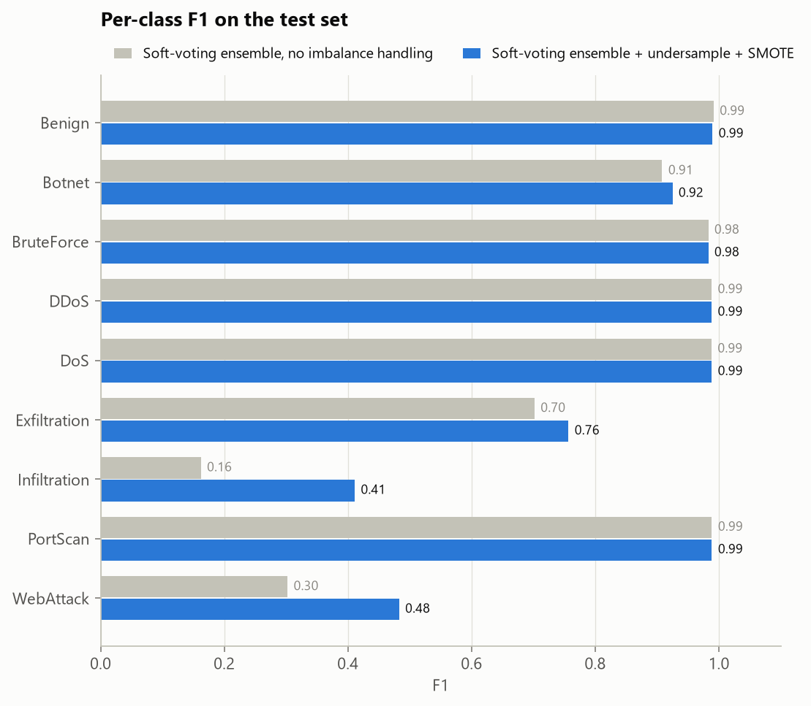
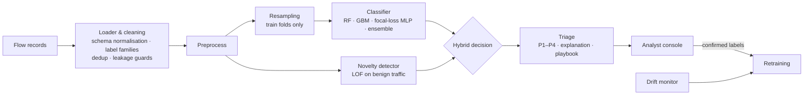

# NetSentinel: imbalance-aware network intrusion detection

[](../../actions/workflows/ci.yml)


**DataNova Global Data-thon 2026 · DN-CY-01: Network Intrusion Detection with Imbalanced Threat Data**

> Develop a network intrusion detection model that handles highly imbalanced threat data and adapts to evolving attack
> patterns. Expected outcome: a detection model with robust performance on minority classes and an alert triage interface.

NetSentinel is an end-to-end intrusion detection system for labelled network-flow data:

- 🎯 **Imbalance-aware detection.** 5 models (incl. a PyTorch MLP with focal loss and a soft-voting ensemble) ×
  4 imbalance strategies (class weights, SMOTE, undersampling + SMOTE), selected on validation and evaluated once on
  a held-out test set against the same model without imbalance handling.
- 🧭 **Open-world detection.** A Local Outlier Factor detector trained on benign traffic only turns
  "benign-looking but unlike any benign traffic" into `Unknown-Anomaly` alerts at an explicit false-alarm budget,
  tested by leave-one-attack-out.
- 📉 **Drift-aware.** A temporal experiment, a label-free drift monitor (PSI on *alerted* traffic, prediction-mix
  shift, unknown-rate rise) and retraining from analyst-confirmed labels.
- 🚨 **Analyst triage console.** Flow alerts grouped into incidents (family + shared endpoint + time), P1–P4 queue,
  per-alert explanations, response playbooks.
- 🔁 **Closed feedback loop.** Every analyst decision is stored with the flow's features, so it is a labelled training
  example. `nids retrain` (or one button in the console) retrains on them, compares old vs. new on test flows nobody
  reviewed, deploys the new model and archives the old one.

## Results

> ⚠️ Current numbers are on the bundled **synthetic** dataset (100k flows, 9 classes, largest:smallest class ≈ 560:1),
> built so the whole pipeline runs before the official data is released. They demonstrate the method, not real-world
> performance. `python -m nids all --data <official data>` regenerates everything, including
> [`reports/REPORT.md`](reports/REPORT.md).

**Held-out test set (20,000 flows): same model, with vs. without imbalance handling**

| Metric | Ensemble, no imbalance handling | Ensemble + undersampling + SMOTE | + novelty detector (deployed) |
|---|---|---|---|
| Macro-F1 | 0.779 | **0.835** | 0.834 |
| Rare-class F1 (families < 1% of traffic) | 0.519 | **0.644** | 0.644 |
| Macro recall | 0.745 | **0.867** | 0.866 |
| Macro PR-AUC | 0.823 | **0.860** | 0.860 |
| Detection rate (attacks alerted) | 93.6% | 95.7% | **95.8%** |
| False-alarm rate (benign alerted) | **0.12%** | 0.98% | 2.16% |

Imbalance handling lifts the rarest families most: Infiltration F1 0.16 → 0.41, WebAttack 0.30 → 0.48, Exfiltration
0.70 → 0.76. The price is a higher benign false-alarm rate, which incident grouping absorbs. The novelty detector's
budget is configurable.

| Experiment | Result |
|---|---|
| Benchmark | 20 configurations (5 models × 4 strategies), winner picked on validation only. Resampling helps every non-linear model (gradient boosting 0.757 → 0.825 macro-F1) but hurts logistic regression, whose false-alarm rate jumps to 5–24% |
| Unseen attack families (leave-one-attack-out) | **40.5% → 59.1%** of a never-seen family's flows raise an alert with the LOF novelty detector (+1.2 pp benign false alarms); brute force 24% → 88%, port scans 72% → 98% |
| Drift (train on past, test on future) | Macro-F1 0.843 → **0.735** on recent traffic → **0.838** after retraining with 10% of recent flows labelled. The label-free monitor fired (PSI 1.79 on alerted traffic vs. 0.04 on all traffic) |
| Feedback loop | A simulated analyst-day (100 incidents → 235 labelled flows) and `nids retrain`: on the 19,765 test flows nobody reviewed, rare-class F1 **0.432 → 0.493**, macro-F1 0.740 → 0.767, false alarms +0.13 pp |
| Alert triage | 4,135 flow alerts → **430 incidents** (10× fewer items for an analyst): 129 P1, 113 P2, and 188 P3 that are mostly single-flow novelty leads |
| Throughput | ≈ 24,000 flows/s for classifier + novelty detector on one laptop CPU |

<p align="center"></p>

## Quick start

```bash
python -m venv .venv
```
```bash
.venv/Scripts/activate        # Windows  (Linux/macOS: source .venv/bin/activate)
```
```bash
pip install -r requirements.txt
```
```bash
pip install torch --index-url https://download.pytorch.org/whl/cpu   # optional: deep model (CPU build)
```
```bash
pip install -e . --no-deps
```

Run everything (synthetic demo data is generated on first run; ~15 min on a laptop):

```bash
python -m nids all
```

Open the analyst console:

```bash
streamlit run app/streamlit_app.py
```

Run on the official or any public dataset (CIC-IDS2017/2018, UNSW-NB15, NSL-KDD, or your own CSV/Parquet):

```bash
python -m nids all --data data/raw/official
```

### Commands

| Command | What it does | Output |
|---|---|---|
| `python -m nids generate-data` | Synthetic CIC-IDS2017-style flows with imbalance, overlap, label noise and drift | `data/raw/synthetic_flows.csv` |
| `python -m nids benchmark` | Every model × imbalance strategy, scored on validation | `reports/results/benchmark.json`, heatmaps |
| `python -m nids train` | Best configuration → test-set evaluation vs. no-imbalance baseline, explanations, model bundle, alert queue | `artifacts/netsentinel_model.joblib`, `artifacts/alerts_test.csv` |
| `python -m nids novelty` | Leave-one-attack-out: can it alert on families it never saw? | `reports/results/novelty.json` |
| `python -m nids drift` | Train on the past, test on the future, monitor drift, retrain with a labelled sample | `reports/results/drift.json` |
| `python -m nids retrain` | Retrain the deployed model with the analyst decisions saved by the console; old model archived | `artifacts/netsentinel_model.joblib`, `reports/results/retrain.json` |
| `python -m nids simulate-feedback` | Simulated analyst labels the top incidents of the test queue (demo of the loop without a SOC) | `artifacts/simulated_feedback.csv` |
| `python -m nids report` | Builds the evaluation report from the results | `reports/REPORT.md` |
| `python -m nids score --input new.csv` | Scores new traffic with the saved model, groups alerts into incidents | `artifacts/alerts.csv`, `artifacts/alerts_incidents.csv` |
| `python -m nids all` | Benchmark → train → novelty → drift → simulated feedback loop → report | everything |

All settings live in [`configs/default.yaml`](configs/default.yaml).

## How it works



1. **Data.** Format-agnostic loader (CIC-IDS, UNSW-NB15, headerless NSL-KDD, generic CSV/Parquet). Fine-grained labels
   are grouped into attack families. IPs, flow IDs and timestamps are removed from the features (kept as analyst
   context) to prevent the model memorising the capture setup. Exact duplicates are dropped before splitting.
2. **Imbalance.** Resampling lives inside an `imblearn` pipeline, so synthetic or dropped rows only ever affect
   training folds. Validation and test sets keep the real class distribution.
3. **Selection & evaluation.** Validation picks the configuration (macro-F1); the test set is scored once. Metrics:
   macro-F1, rare-class F1 (families < 1% of traffic), per-class PR-AUC, MCC, detection and false-alarm rates.
4. **Unknown attacks.** Classifier says *benign* + LOF says *unlike benign* → `Unknown-Anomaly`. The threshold is the
   99th percentile of benign validation scores (1% false-alarm budget, configurable).
5. **Drift.** PSI on all traffic, PSI on alerted traffic, PSI of the predicted-class mix and the unknown-alert rate
   drive a retraining trigger; retraining uses analyst-confirmed labels from the console.
6. **Triage.** Priority = severity × confidence (+ anomaly boost) → P1–P4; explanations name the features that deviate
   most from the benign baseline; each family has a first-response playbook. Flow alerts are grouped into incidents
   (same family, shared victim/source/C2, no gap over an hour), so analysts work tickets instead of flows.

Details and design decisions: [`docs/METHODOLOGY.md`](docs/METHODOLOGY.md).

## Repository layout

```
configs/default.yaml        all settings (data, models, imbalance, novelty, drift, triage)
src/nids/
  data.py                   loading, schema/label normalisation, leakage guards, splits
  synthetic.py              synthetic flow generator (imbalance, overlap, label noise, drift)
  features.py               preprocessing
  resampling.py             imbalance strategies
  models.py  deep.py        model zoo; PyTorch focal-loss MLP
  evaluate.py  plotting.py  imbalance-robust metrics and figures
  novelty.py                LOF / Isolation Forest novelty detection, PSI
  triage.py  bundle.py      alert prioritisation, explanations, deployable model bundle
  experiments.py            benchmark · train · novelty · drift
  report.py  cli.py         report generation, command line
app/streamlit_app.py        analyst triage console
scripts/                    novelty-detector comparison
tests/                      unit + end-to-end tests
reports/                    REPORT.md, figures/, results/*.json (generated)
docs/                       methodology, data guide, presentation outline, submission checklist
```

## Documentation

| Document | Contents |
|---|---|
| [`reports/REPORT.md`](reports/REPORT.md) | Full evaluation: benchmark, test results, explainability, novel attacks, drift |
| [`docs/METHODOLOGY.md`](docs/METHODOLOGY.md) | Design decisions and why |
| [`docs/DATASET.md`](docs/DATASET.md) | Synthetic data, plugging in the official dataset, leakage checklist, public datasets |
| [`docs/PRESENTATION.md`](docs/PRESENTATION.md) | Slide outline, demo script, judge Q&A |
| [`docs/SUBMISSION_CHECKLIST.md`](docs/SUBMISSION_CHECKLIST.md) | Requirements and judging criteria → evidence |
| [`README.ru.md`](README.ru.md) | Руководство на русском |

## Testing

```bash
pytest -q
```

Covers loaders for CIC / UNSW / NSL-KDD layouts, label mapping, resampling, metrics, triage, novelty detection,
every classic model × strategy pair, the PyTorch model, and an end-to-end run of every command.

## Docker

```bash
docker build -t netsentinel .
```
```bash
docker run -p 8501:8501 netsentinel
```

## Limitations

- Flow statistics only: attacks that leave flow features untouched need payload inspection (pair with Suricata/Zeek).
- Stratified random splits put flows of one attack session in train and test; the temporal experiment is the more
  realistic estimate.
- Attacks crafted to resemble benign sessions (e.g. web attacks inside normal HTTP traffic) remain hard for any
  flow-level anomaly detector; this is measured and reported, not hidden.

## Author

**Rustamjonov Komron Davronovich** ([@wpersonxdd](https://github.com/wpersonxdd)) · Computer Science / Cybersecurity · DataNova Global Data-thon 2026

Licensed under the [MIT License](LICENSE).
