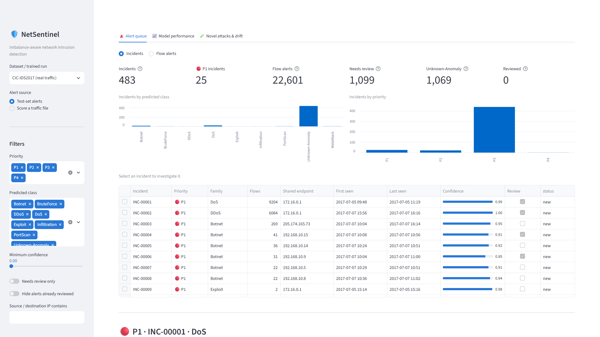
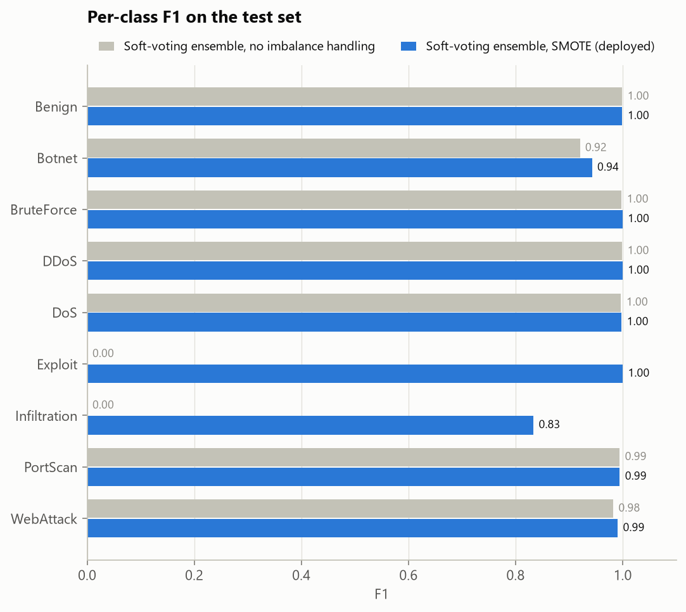
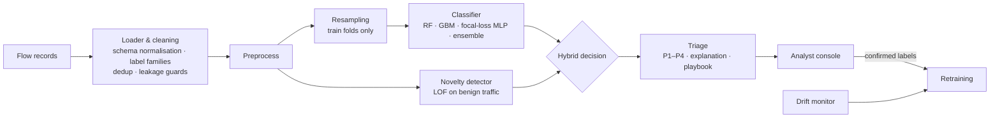

# NetSentinel: imbalance-aware network intrusion detection


**DataNova Global Data-thon 2026 · DN-CY-01: Network Intrusion Detection with Imbalanced Threat Data**

> Develop a network intrusion detection model that handles highly imbalanced threat data and adapts to evolving attack
> patterns. Expected outcome: a detection model with robust performance on minority classes and an alert triage interface.

NetSentinel is an end-to-end intrusion detection system for labelled network-flow data:

- 🎯 **Imbalance-aware detection.** 5 models (incl. a PyTorch MLP with focal loss and a soft-voting ensemble) ×
  4 imbalance strategies (class weights, SMOTE, undersampling + SMOTE), selected on validation and evaluated once on
  a held-out test set against the same model without imbalance handling.
- 📏 **Numbers you can trust.** Automatic data audit with a single-feature shortcut scan, stratified-bootstrap 95%
  confidence intervals, a paired test of whether each gain is luck, and the same model under random,
  session-grouped and temporal splits to show how optimistic the headline is.
- 🎯 **New: per-family guarantees.** Mondrian conformal prediction turns probabilities into sets of plausible
  families with a ≥ 90% coverage guarantee for *every* family, rare ones included. Alerts show "WebAttack | Benign"
  instead of false certainty; an ambiguous set is a second "needs review" trigger next to low confidence.
- 🧭 **Open-world detection.** A Local Outlier Factor detector trained on benign traffic only turns
  "benign-looking but unlike any benign traffic" into `Unknown-Anomaly` alerts at an explicit false-alarm budget,
  tested by leave-one-attack-out.
- 📉 **Drift-aware.** A temporal experiment, a label-free drift monitor (PSI on *alerted* traffic, prediction-mix
  shift, unknown-rate rise) and retraining from analyst-confirmed labels.
- 🚨 **Analyst triage console.** Flow alerts grouped into incidents (family + shared endpoint + time), P1–P4 queue,
  per-alert explanations, response playbooks.
- 🔁 **Closed feedback loop.** Every analyst decision is stored with the flow's features, so it is a labelled training
  example. `nids retrain` (or one button in the console) retrains on them, compares old vs. new on test flows nobody
  reviewed, deploys the new model and archives the old one.

## Presentation and demo video

| | |
|---|---|
| 🎬 **Demo video** (≈ 6 min, animated, narrated, English captions) | [`docs/media/NetSentinel_demo.mp4`](docs/media/NetSentinel_demo.mp4) · captions [`NetSentinel_demo.srt`](docs/media/NetSentinel_demo.srt) |
| 📑 **Slides** (14 slides, PDF) | [`docs/NetSentinel_slides.pdf`](docs/NetSentinel_slides.pdf) · single images in [`docs/media/slides/`](docs/media/slides) |
| 🖥️ **Console screenshots** | [`docs/media/screens/`](docs/media/screens) |

[](docs/media/NetSentinel_demo.mp4)

<sub>The analyst console on real CIC-IDS2017 traffic: 22,601 flow alerts grouped into 483 incidents with priority,
family, shared endpoint and confidence. Click the image for the demo video.</sub>

## Results

Two evaluations, each with its own full report:

| | Data | Report |
|---|---|---|
| **Real traffic** | **CIC-IDS2017**: 5 days of labelled traffic, 2.8 M flows → 2.52 M after cleaning → stratified 606k sample, 9 families, largest:smallest ≈ 45,000:1 | [`reports/cicids2017/REPORT.md`](reports/cicids2017/REPORT.md) |
| Synthetic stress test | 100k generated flows with deliberate overlap, label noise and an injected new attack family | [`reports/REPORT.md`](reports/REPORT.md) |

When the official DataNova data is released, `python -m nids all --data <folder>` produces the same report for it.

### Real traffic: CIC-IDS2017

**Held-out test set (121,196 flows)**, ensemble + SMOTE vs. the same ensemble without imbalance handling, 95%
stratified-bootstrap CIs:

| Metric | No imbalance handling | + SMOTE | + novelty detector (deployed) |
|---|---|---|---|
| Macro-F1, all 9 families | 0.766 [0.763, 0.768] | **0.973** [0.945, 0.992] | 0.973 [0.945, 0.991] |
| Macro-F1, families with ≥ 10 test flows | 0.984 [0.981, 0.988] | **0.989** [0.986, 0.992] | 0.988 [0.986, 0.991] |
| Detection rate (attacks alerted) | 99.55% | **99.87%** | 99.87% |
| False-alarm rate (benign alerted) | **0.09%** | 0.10% | 1.18% |

Read the first two rows together. The jump in all-family macro-F1 comes almost entirely from **9 test flows of the two
tiniest families**: Heartbleed (2 of 2 found vs. 0 of 2) and Infiltration (5 of 7 vs. 0 of 7). On the families that can
actually be measured, imbalance handling adds a small but significant **+0.005 [+0.003, +0.007]**. Both facts are in the
report, and the tiny families are given as counts because no bootstrap can express the uncertainty of a 2-flow class.

| Experiment | Result on CIC-IDS2017 |
|---|---|
| **Evaluation protocols** | Same model, three splits: random **0.973** · session-grouped **0.888** [0.836, 0.912] (session leakage *detected*: flows of one session on both sides inflate the random split) · temporal **0.180**. Every CIC attack happens on a single day, so a model trained on Mon–Thu morning has never seen Friday's DDoS, PortScan or Botnet: **a supervised IDS only knows yesterday's attacks** |
| Unseen attack families (leave-one-attack-out) | Classifier alone: **5%** of a never-seen family's flows alerted → with the LOF novelty detector **33%**. Web attacks 3% → 87%, DoS 3% → 71%, DDoS 24% → 40%; port scans, brute force and botnet beacons stay almost invisible at flow level (0–3%) |
| Drift (train on the past, test on the future) | Macro-F1 0.998 on history (Mon – Thu morning) → **0.182** on Thursday afternoon and Friday → **0.925** after retraining with 10% labelled recent flows. All three label-free drift signals fired (alerted-traffic PSI 5.3, prediction-mix PSI 0.17, Unknown-Anomaly rate 0.9% → 5.4%). Families first seen in the future: DDoS 61% alerted before retraining → 99.9% recall after; PortScan 38% → 99.6% |
| Data audit | 288,602 empty rows, 308,218 duplicates, a 12-hour clock without AM/PM and mixed date formats repaired; no ID/clock-like columns; no single feature reaches more than 37% of the full model (one flagged feature isolates one family) |
| Conformal guarantees (new) | 7 of 9 families get a ≥ 90% coverage guarantee; the classifier is confident enough that **100% of prediction sets hold a single family**. Heartbleed and Infiltration have 1 and 4 calibration flows, below the 9 a 90% guarantee needs, and the report says so instead of faking one |
| Alert triage | 22,601 flow alerts → **483 incidents** (47× fewer): 25 P1, 21 P2, 436 P3 (mostly single-flow novelty leads) |
| Feedback loop | Simulated analyst-day (100 incidents → 20,864 labelled flows) + `nids retrain`: on the 100,332 test flows nobody reviewed, macro-F1 **+0.026 [+0.004, +0.049]**, false alarms +0.17 pp |
| Throughput | ≈ 25,000 flows/s (classifier + novelty detector, one laptop) |

<p align="center"></p>

### Synthetic stress test

The generator makes rare families overlap with benign traffic (web attacks inside normal HTTP, infiltration that looks
like SMB, encrypted C2), adds 2% label noise and injects a brand-new family (Exfiltration) in the last third of the
timeline. That makes imbalance handling matter far more than on CIC-IDS2017:

| Metric (20,000 test flows, 95% CIs) | Ensemble, no imbalance handling | Ensemble + undersampling + SMOTE | + novelty detector |
|---|---|---|---|
| Macro-F1 | 0.779 [0.754, 0.805] | **0.835** [0.815, 0.854] | 0.834 [0.815, 0.853] |
| Rare-class F1 (families < 1% of traffic) | 0.519 [0.460, 0.574] | **0.644** [0.601, 0.687] | 0.644 [0.601, 0.687] |
| False-alarm rate | **0.12%** | 0.98% | 2.16% |

Paired bootstrap: **+0.055 macro-F1 [+0.032, +0.084]**, **+0.125 rare-class F1 [+0.072, +0.188]**, at +0.87 pp false
alarms. Unseen families 40.5% → 59.1% alerted with the novelty detector; drift 0.843 → 0.735 → 0.838 after retraining;
4,135 alerts → 430 incidents; feedback loop +0.060 rare-class F1 [+0.016, +0.104]. Details in
[`reports/REPORT.md`](reports/REPORT.md).

## Quick start

```bash
python -m venv .venv
```
```bash
.venv/Scripts/activate        # Windows  (Linux/macOS: source .venv/bin/activate)
```
```bash
pip install -r requirements.txt
```
```bash
pip install torch --index-url https://download.pytorch.org/whl/cpu   # optional: deep model (CPU build)
```
```bash
pip install -e . --no-deps
```

Run everything (synthetic demo data is generated on first run; ~15 min on a laptop):

```bash
python -m nids all
```

Open the analyst console:

```bash
streamlit run app/streamlit_app.py
```

Reproduce the real-traffic results: download `GeneratedLabelledFlows.zip` from the
[CIC-IDS2017 page](https://www.unb.ca/cic/datasets/ids-2017.html), extract the eight CSVs into `data/raw/cicids2017/`
and run (≈ 1 hour on a laptop; the console then offers both runs):

```bash
python -m nids all --config configs/cicids2017.yaml
```

Run on the official or any public dataset (CIC-IDS2017/2018, UNSW-NB15, NSL-KDD, or your own CSV/Parquet):

```bash
python -m nids all --data data/raw/official
```

### Commands

| Command | What it does | Output |
|---|---|---|
| `python -m nids generate-data` | Synthetic CIC-IDS2017-style flows with imbalance, overlap, label noise and drift | `data/raw/synthetic_flows.csv` |
| `python -m nids benchmark` | Every model × imbalance strategy, scored on validation | `reports/results/benchmark.json`, heatmaps |
| `python -m nids train` | Best configuration → test-set evaluation with 95% CIs vs. no-imbalance baseline, conformal calibration, explanations, model bundle, alert queue | `artifacts/netsentinel_model.joblib`, `artifacts/alerts_test.csv` |
| `python -m nids audit` | Data quality, ID/clock-like columns, single-feature shortcut scan | `reports/results/audit.json` |
| `python -m nids protocols` | Same model under random, session-grouped and temporal splits, with 95% CIs | `reports/results/protocols.json` |
| `python -m nids novelty` | Leave-one-attack-out: can it alert on families it never saw? | `reports/results/novelty.json` |
| `python -m nids drift` | Train on the past, test on the future, monitor drift, retrain with a labelled sample | `reports/results/drift.json` |
| `python -m nids retrain` | Retrain the deployed model with the analyst decisions saved by the console; old model archived | `artifacts/netsentinel_model.joblib`, `reports/results/retrain.json` |
| `python -m nids simulate-feedback` | Simulated analyst labels the top incidents of the test queue (demo of the loop without a SOC) | `artifacts/simulated_feedback.csv` |
| `python -m nids report` | Builds the evaluation report from the results | `reports/REPORT.md` |
| `python -m nids score --input new.csv` | Scores new traffic with the saved model, groups alerts into incidents | `artifacts/alerts.csv`, `artifacts/alerts_incidents.csv` |
| `python -m nids all` | Benchmark → train → audit → protocols → novelty → drift → simulated feedback loop → report | everything |

All settings live in [`configs/default.yaml`](configs/default.yaml); [`configs/cicids2017.yaml`](configs/cicids2017.yaml) overrides what the real dataset needs (date format,
12-hour clock, sample size). Every command accepts `--config`.

## How it works



1. **Data.** Format-agnostic loader (CIC-IDS, UNSW-NB15, headerless NSL-KDD, generic CSV/Parquet). Fine-grained labels
   are grouped into attack families. IPs, flow IDs and timestamps are removed from the features (kept as analyst
   context) to prevent the model memorising the capture setup. Exact duplicates are dropped before splitting.
2. **Imbalance.** Resampling lives inside an `imblearn` pipeline, so synthetic or dropped rows only ever affect
   training folds. Validation and test sets keep the real class distribution.
3. **Selection & evaluation.** Validation picks the configuration (macro-F1); the test set is scored once. Metrics:
   macro-F1, rare-class F1 (families < 1% of traffic), per-class PR-AUC, MCC, detection and false-alarm rates.
4. **Unknown attacks.** Classifier says *benign* + LOF says *unlike benign* → `Unknown-Anomaly`. The threshold is the
   99th percentile of benign validation scores (1% false-alarm budget, configurable).
5. **Drift.** PSI on all traffic, PSI on alerted traffic, PSI of the predicted-class mix and the unknown-alert rate
   drive a retraining trigger; retraining uses analyst-confirmed labels from the console.
6. **Triage.** Priority = severity × confidence (+ anomaly boost) → P1–P4; explanations name the features that deviate
   most from the benign baseline; each family has a first-response playbook. Flow alerts are grouped into incidents
   (same family, shared victim/source/C2, no gap over an hour), so analysts work tickets instead of flows.

Details and design decisions: [`docs/METHODOLOGY.md`](docs/METHODOLOGY.md).

## Repository layout

```
configs/default.yaml        all settings (data, models, imbalance, novelty, drift, triage)
configs/cicids2017.yaml     overrides for the real CIC-IDS2017 run
src/nids/
  data.py                   loading, schema/label normalisation, leakage guards, splits
  synthetic.py              synthetic flow generator (imbalance, overlap, label noise, drift)
  features.py               preprocessing
  resampling.py             imbalance strategies
  models.py  deep.py        model zoo; PyTorch focal-loss MLP
  evaluate.py  plotting.py  imbalance-robust metrics and figures
  novelty.py                LOF / Isolation Forest novelty detection, PSI
  conformal.py              Mondrian conformal prediction (per-family coverage guarantees)
  audit.py                  data quality and shortcut scan
  triage.py  bundle.py      alert prioritisation, incidents, explanations, deployable model bundle
  feedback.py               analyst decisions -> labelled training data
  experiments.py            benchmark · train · audit · protocols · novelty · drift · retrain
  report.py  cli.py         report generation, command line
app/streamlit_app.py        analyst triage console
scripts/                    novelty-detector comparison, demo traffic, slide/video rendering
tests/                      unit + end-to-end tests
reports/                    synthetic run: REPORT.md, figures/, results/*.json (generated)
reports/cicids2017/         real-traffic run: REPORT.md, figures/, results/*.json (generated)
presentation/               slide sources (one HTML file per slide), animated video scenes and narration
docs/                       methodology, data guide, slides PDF, demo video, submission checklist
```

## Documentation

| Document | Contents |
|---|---|
| [`reports/cicids2017/REPORT.md`](reports/cicids2017/REPORT.md) | Full evaluation on real CIC-IDS2017 traffic |
| [`reports/REPORT.md`](reports/REPORT.md) | Full evaluation on the synthetic stress test |
| [`docs/METHODOLOGY.md`](docs/METHODOLOGY.md) | Design decisions and why |
| [`docs/DATASET.md`](docs/DATASET.md) | Synthetic data, plugging in the official dataset, leakage checklist, public datasets |
| [`docs/NetSentinel_slides.pdf`](docs/NetSentinel_slides.pdf) | Presentation slides |
| [`docs/PRESENTATION.md`](docs/PRESENTATION.md) | Talk outline, live-demo script, judge Q&A |
| [`docs/SUBMISSION_CHECKLIST.md`](docs/SUBMISSION_CHECKLIST.md) | Requirements and judging criteria → evidence |
| [`README.ru.md`](README.ru.md) | Руководство на русском |

## Testing

```bash
pytest -q
```

81 tests cover loaders for CIC / UNSW / NSL-KDD layouts, label mapping, resampling, metrics, conformal prediction,
bootstrap intervals, the data audit, triage, novelty detection, the feedback loop, every classic model × strategy
pair, the PyTorch model, and an end-to-end run of every command.

A GitHub Actions workflow is included as [`.github/ci.yml`](.github/ci.yml); move it to `.github/workflows/ci.yml`
to run the tests on every push.

Regenerate the slides and the video (optional tools: `pip install playwright imageio-ffmpeg`; the narration uses
Windows text-to-speech). The video is a set of animated HTML scenes in [`presentation/video/`](presentation/video)
rendered frame by frame, with the narration in [`script.json`](presentation/video/script.json):

```bash
python scripts/make_media.py slides --deck presentation/project --out docs/media/slides --pdf docs/NetSentinel_slides.pdf
```
```bash
python scripts/make_media.py motion --out docs/media/NetSentinel_demo.mp4
```

## Docker

```bash
docker build -t netsentinel .
```
```bash
docker run -p 8501:8501 netsentinel
```

## Limitations

- Flow statistics only: attacks that leave flow features untouched need payload inspection (pair with Suricata/Zeek).
  On CIC-IDS2017, port scans, brute force and botnet beacons are almost invisible to the novelty detector.
- A supervised model only knows the attacks it was trained on: on CIC-IDS2017 the temporal split scores 0.18
  macro-F1. The novelty detector and fast retraining reduce this gap but do not close it.
- The novelty detector's 1% false-alarm budget is a real cost (0.10% → 1.18% of benign flows alerted on
  CIC-IDS2017); tune it to the size of the analyst team.
- Stratified random splits put flows of one attack session in train and test; the session-grouped and temporal
  experiments are the more realistic estimates.
- CIC-IDS2017 is from 2017 and has known labelling issues; the two rarest families have 2 and 7 test flows, so
  their results are reported as counts.
- Attacks crafted to resemble benign sessions (e.g. web attacks inside normal HTTP traffic) remain hard for any
  flow-level anomaly detector; this is measured and reported, not hidden.

## Author

**Rustamjonov Komron Davronovich** ([@wpersonxdd](https://github.com/wpersonxdd)) · Computer Science / Cybersecurity · DataNova Global Data-thon 2026

Licensed under the [MIT License](LICENSE).
