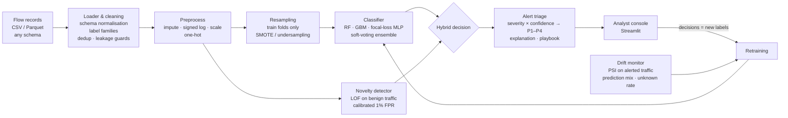
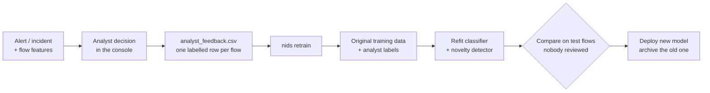

# Methodology

NetSentinel treats intrusion detection as four connected problems, not one classifier:

1. **Severe class imbalance.** Benign traffic is ~80% of flows and the rarest attack family is ~0.15%. A model can
   score high accuracy while missing every rare attack.
2. **Open world.** Attackers do not restrict themselves to the families in the training labels.
3. **Non-stationarity.** Attack patterns and the network itself change over time.
4. **Humans act on the output.** A SOC analyst needs a short, ranked, explained queue, not a probability vector.

## 1. Data handling

| Step | What | Why |
|---|---|---|
| Schema normalisation | Column names → snake_case; CIC-IDS, UNSW-NB15, NSL-KDD (headerless) and generic CSV/Parquet supported | The official dataset's format is unknown in advance |
| Label families | `DoS Hulk`, `DoS slowloris` → `DoS`; `Web Attack – XSS` → `WebAttack`; NSL-KDD names → DoS/Probe/R2L/U2R | Fine-grained classes with a dozen samples cannot be learned; families are also what a SOC acts on. `label_mode: raw` keeps the originals |
| Leakage guards | IPs, ports of the *source*, flow IDs and timestamps are removed from features and kept only as analyst context | Otherwise the model memorises *which lab hosts attacked* instead of *how attacks behave* |
| Exact duplicates removed | Before splitting | Duplicates landing in both train and test inflate scores (a known CIC-IDS2017 issue) |
| `Infinity` / missing values | → NaN → median imputation inside the pipeline | CIC-IDS flow rates divide by zero-duration flows |
| Too-rare classes | Classes with < `min_class_count` samples are dropped with a warning | They can be neither learned nor evaluated honestly |
| Signed log transform | `sign(x)·log(1+|x|)` before scaling | Byte/packet/rate counters span 8+ orders of magnitude |

Split: stratified 70 / 10 / 20 (train / validation / test). Every class appears in every part. **Model selection uses
only the validation set**; the test set is scored once, by `train`.

## 2. Imbalance strategies

| Strategy | Mechanism | Trade-off |
|---|---|---|
| `none` | Natural distribution | Baseline; rare classes are effectively ignored by the loss |
| `class_weight` | Loss weight ∝ 1 / class frequency (square root for the MLP) | No new data; can over-predict rare classes → false alarms |
| `smote` | Synthetic minority rows by interpolating between same-class neighbours, each minority raised to ≥15% of the majority | Better minority recall; synthetic rows only ever enter *training* folds |
| `hybrid` | Random undersampling of the majority (cap = 4× the second-largest class), then SMOTE | Faster training, usually a good precision/recall balance |

Resampling runs as a step of an `imblearn.Pipeline`, so it is impossible for synthetic or removed rows to leak into
validation or test data.

## 3. Models

| Model | Role |
|---|---|
| Logistic regression | Linear baseline, sanity check |
| Random forest | Strong bagging baseline for tabular flows |
| Histogram gradient boosting | Boosted trees; usually the strongest single model on flow features |
| Deep MLP (PyTorch) | 3 hidden layers, batch-norm, dropout, **focal loss** (γ = 2): down-weights easy benign flows so gradients come from hard, rare attacks. Early stopping on validation macro-F1 |
| Soft-voting ensemble | RF + GBM + MLP probabilities averaged; different inductive biases make errors less correlated |

Every model × every strategy is benchmarked; the configuration with the best validation macro-F1 (ties broken by
rare-class recall) is deployed.

## 4. Evaluation protocol

Accuracy is not reported as a headline: predicting "benign" for every flow already scores ~80%.

| Metric | Why |
|---|---|
| **Macro-F1** | Every class counts equally; the selection metric |
| **Rare-class F1** | Macro-F1 restricted to attack families below 1% prevalence, the problem statement's "minority classes" |
| Per-class precision / recall / F1 | Where exactly the model fails |
| **PR-AUC** (average precision) | Threshold-free; unlike ROC-AUC it is not flattered by the huge benign class |
| MCC | Single imbalance-robust summary |
| Detection rate / false-alarm rate | The SOC view: *was an alert raised?* (a wrong family name still alerts the analyst) |
| Latency | ms per 1,000 flows → throughput |

The final model is compared against **the same model trained without imbalance handling** on the same test set,
so the gain from imbalance handling is isolated from model choice.

## 5. Novel attacks (open world)

**Hybrid decision.** A novelty detector is trained on benign traffic only. When the classifier says *benign* but the
detector says the flow is unlike benign traffic, the flow becomes an `Unknown-Anomaly` alert. The threshold is the
99th percentile of anomaly scores on benign *validation* flows, so the false-alarm cost is an explicit budget
(`novelty.benign_fpr`, default 1%).

**Detector choice.** At the same 1% false-alarm budget on the synthetic benchmark
(`python scripts/compare_novelty_detectors.py`):

| Detector | Mean | BruteForce | Botnet | DoS | Exfiltration | Infiltration | WebAttack | DDoS / PortScan |
|---|---|---|---|---|---|---|---|---|
| Isolation Forest | 31% | 4% | 0% | 44% | 7% | 3% | 0% | 95% / 98% |
| Autoencoder (PyTorch) | 51% | 24% | **36%** | 97% | **55%** | 0% | 0% | 98% / 98% |
| **Local Outlier Factor (k = 10)** | **59%** | **88%** | 20% | **98%** | 52% | 12% | **6%** | 98% / 98% |
| Local Outlier Factor (k = 30) | 60% | 89% | 16% | 98% | 52% | **27%** | 3% | 98% / 98% |

LOF has the best mean detection (k = 10 and k = 30 are within noise of each other), needs no training loop, and
catches far more brute-force and infiltration traffic than the alternatives.
Benign traffic is a mixture of very different services (DNS, HTTPS, SMB, SSH…). Isolation Forest scores every flow
against one global picture, while LOF compares each flow with the density of its *own* neighbourhood. The
autoencoder is clearly better on botnet beacons and its results vary with the random seed. Combining LOF and
autoencoder scores is the natural next step. LOF is the default (`novelty.method`); Isolation Forest is a config
option.

**Evaluation: leave-one-attack-out.** Each attack family is removed from training in turn; we measure how much of it
is still raised as an alert by (a) the classifier alone and (b) classifier + novelty detector.

**Honest limit:** attacks engineered to look like benign traffic (web attacks inside normal HTTP sessions) remain
hard for any flow-level anomaly detector. That is a limitation of the flow features, not of the threshold, and it is
reported as such.

## 6. Drift over time

When timestamps exist, the drift experiment trains on the oldest 65% of traffic and evaluates on the newest 35%:

1. **Static model** on recent traffic → how much performance decays.
2. **Label-free drift monitor**, i.e. signals available in production without ground truth:
   - PSI per feature on **all** traffic,
   - PSI per feature on **alerted** traffic. Attacks are a small share of flows, so drift inside them barely moves
     whole-traffic distributions; this is the signal that actually fires,
   - PSI of the predicted-class mix,
   - rise of the `Unknown-Anomaly` rate.
3. **Retrained model** with 10% of recent flows labelled, simulating analyst decisions collected through the triage
   console, evaluated on the remaining recent flows.

## 7. Alert triage

| Field | How it is computed |
|---|---|
| Severity | Attack family → none / low / medium / high / critical (`triage.severity` in the config) |
| Priority score | `severity_weight × (0.5 + 0.5 × confidence) + 0.1 × anomalous`, so a confident critical alert outranks an unsure medium one |
| P1–P4 | Cut points 0.70 / 0.45 / 0.25 |
| Needs review | Confidence < 0.6 or unknown family |
| Explanation | The features deviating most from the benign median, in IQR units ("`conn_count_same_dst_10s`=148, 49 IQR above benign median 3"). Model-agnostic and readable without ML knowledge |
| Recommended action | Per-family first-response playbook |
| Global explanation | Permutation importance: drop in validation macro-F1 when a feature is shuffled |
| **Incident** | Flow alerts with the same family and the same *shared endpoint* (whichever of source/destination IP has fewer distinct values within that family: a DDoS shares its victim, a scan its source, a botnet its C2), split when the stream goes quiet for over an hour. An incident takes the priority, explanation and playbook of its strongest flow; incidents with ≥ 20 flows gain +0.15 priority (sustained activity) |
| Unknown-Anomaly severity | `low` by default: a single novel flow is a lead, and ~1% of benign flows trip the detector by design. A sustained unknown incident escalates through the volume rule, so a real new campaign still rises in the queue |

Flow-level detection produces one alert per flow, so a single DDoS campaign alone yields hundreds of them. Analysts
work tickets, not flows: the console opens on incidents and drills down to member flows, and one analyst decision on an
incident labels all of its flows at once, which makes the feedback loop cheap.

## 8. Closing the loop: analyst feedback → retraining

- **Every alert carries its flow's feature values** (`feat_*` columns) and its position in the scored input. A decision
  in the console therefore stores a complete labelled example: features + label, whether the flow came from the test
  split or from a traffic file scored later.
- **Label rules:** *False positive* → `Benign`; *Confirmed* / *Escalated* → the corrected label; *Needs more data* →
  not used; *Other / new family* (or an unresolved `Unknown-Anomaly`) → the family name typed in the note. One decision
  on an incident labels all its member flows.
- **`nids retrain`** (or the button in the console) merges these examples with the original training split and refits
  the classifier with the same model and imbalance strategy. It also refits the novelty detector, so confirmed false
  positives teach it what normal looks like and a family named by an analyst becomes a regular class.
- **Honest comparison:** flows analysts already labelled are removed from the test split before old and new models are
  compared, because they are training data now. The new model replaces the deployed one; the old one is archived in
  `artifacts/model_history/`.
- **Demonstration without a SOC:** `nids simulate-feedback` plays an analyst who opens incidents flagged *needs review*
  first (active learning: human time goes where the model is least sure) and labels every flow correctly from ground
  truth. `nids all` runs this on the test split and reports the before/after in REPORT §8, writing the retrained model
  to a separate file so the deployed model stays as evaluated in §3.

## 9. Reproducibility

- One config file (`configs/default.yaml`) + one seed drive every command.
- Each experiment writes machine-readable results to `reports/results/*.json`; `REPORT.md` is generated from them.
- `pytest` covers loaders (CIC / UNSW / NSL-KDD layouts), label mapping, resampling, metrics, triage, novelty
  detection, every model × strategy pair, and an end-to-end run of every command.
