# NetSentinel: evaluation report

_Generated 2026-10-10 18:36 UTC from `data/raw/synthetic_flows.csv`._

> **Note:** these numbers come from the bundled *synthetic* dataset, which exists so the pipeline can run end-to-end before the official data is available. They demonstrate the method, not real-world performance. Re-run `python -m nids all --data <official dataset>` to regenerate this report.

## 1. Dataset

- Source: `data/raw/synthetic_flows.csv`, label column `label`
- 100,000 flows after cleaning; 28 features (27 numeric, 1 categorical)
- Imbalance ratio (largest / smallest class): **557 : 1**
- Exact duplicate flows removed: 500
- Stratified split: 70,000 train / 10,000 validation / 20,000 test

| Class | Flows | Share |
|---|---|---|
| Benign | 80,214 | 80.21% |
| Botnet | 620 | 0.62% |
| BruteForce | 1,481 | 1.48% |
| DDoS | 4,981 | 4.98% |
| DoS | 7,220 | 7.22% |
| Exfiltration | 144 | 0.14% |
| Infiltration | 172 | 0.17% |
| PortScan | 4,483 | 4.48% |
| WebAttack | 685 | 0.69% |

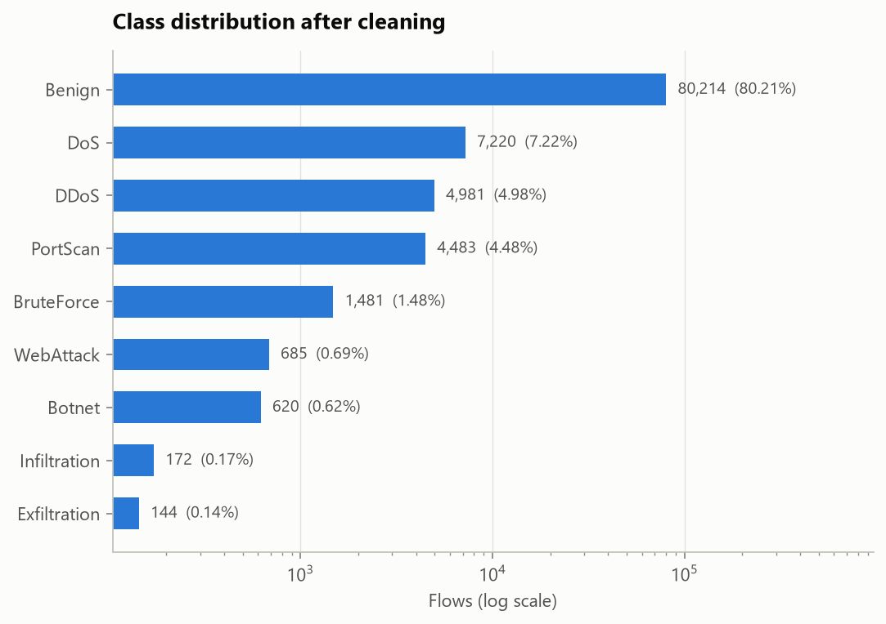

### Data audit

- Missing values: `flow_bytes_s` 0.12%, `flow_packets_s` 0.09% (imputed with the training median inside the pipeline).
- Identifier- or clock-like numeric columns: none found.
- **Shortcut scan.** A depth-4 tree is trained on each feature *alone*. A feature that nearly matches the full model, or perfectly isolates one family, is flagged for a human to judge: real attack behaviour (a scan *is* many destination ports) or a capture artefact (a lab IP, TTL or window size).

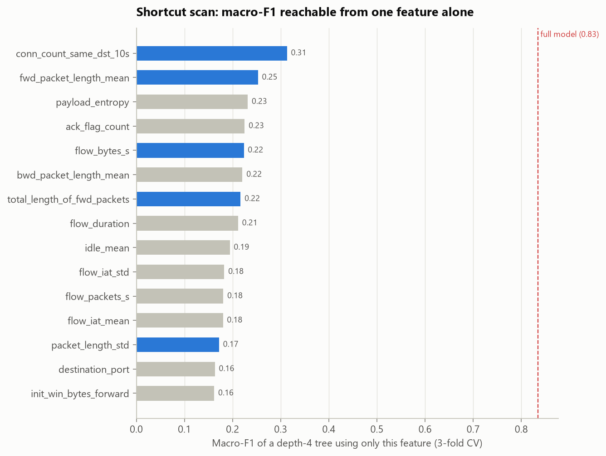

| Feature | Macro-F1 from this feature alone | Share of full model | Family it isolates best (F1) | Flag |
|---|---|---|---|---|
| `conn_count_same_dst_10s` | 0.313 | 38% | DDoS (0.98) | alone isolates a family (F1 >= 0.98) |
| `fwd_packet_length_mean` | 0.253 | 30% | PortScan (0.99) | alone isolates a family (F1 >= 0.98) |
| `payload_entropy` | 0.232 | 28% | PortScan (0.97) | – |
| `ack_flag_count` | 0.225 | 27% | PortScan (0.85) | – |
| `flow_bytes_s` | 0.223 | 27% | PortScan (0.98) | alone isolates a family (F1 >= 0.98) |
| `bwd_packet_length_mean` | 0.221 | 26% | PortScan (0.77) | – |
| `total_length_of_fwd_packets` | 0.217 | 26% | PortScan (0.99) | alone isolates a family (F1 >= 0.98) |
| `flow_duration` | 0.211 | 25% | PortScan (0.83) | – |

Flagged (blue in the chart): `conn_count_same_dst_10s`, `fwd_packet_length_mean`, `flow_bytes_s`, `total_length_of_fwd_packets`, `packet_length_std`. No single feature comes close to the full model, so the classifier is not riding on one shortcut. Flagged features isolate one family each; check that this reflects attack behaviour.

## 2. Benchmark: models × imbalance strategies

Every combination was trained on the training split and scored on the **validation** split. The test split is not touched until section 3.

**Selection score** = macro-F1 over the 9 families with at least 10 validation flows.

**Takeaway:** the winner is **Soft-voting ensemble + undersample + SMOTE**, i.e. an imbalance strategy. Best with imbalance handling: Soft-voting ensemble + undersample + SMOTE (score 0.828, rare-class F1 0.625); best on the natural distribution: Logistic regression (score 0.784, rare-class F1 0.528). Difference: **+0.044** selection score.

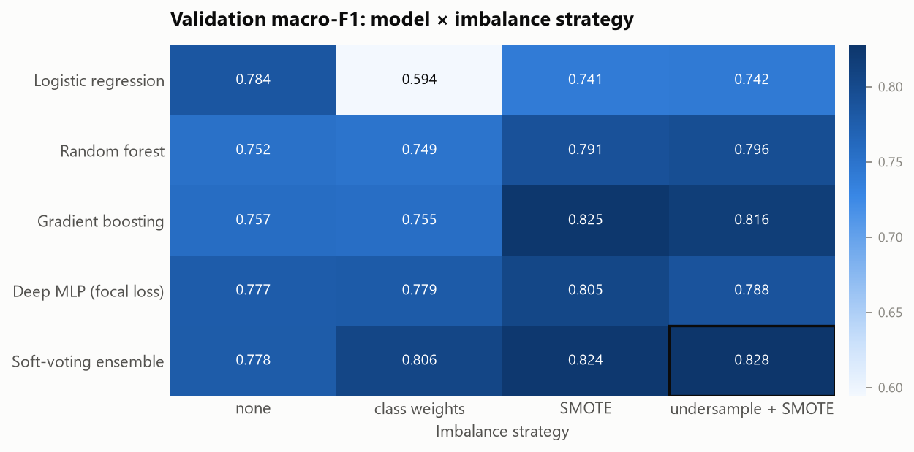

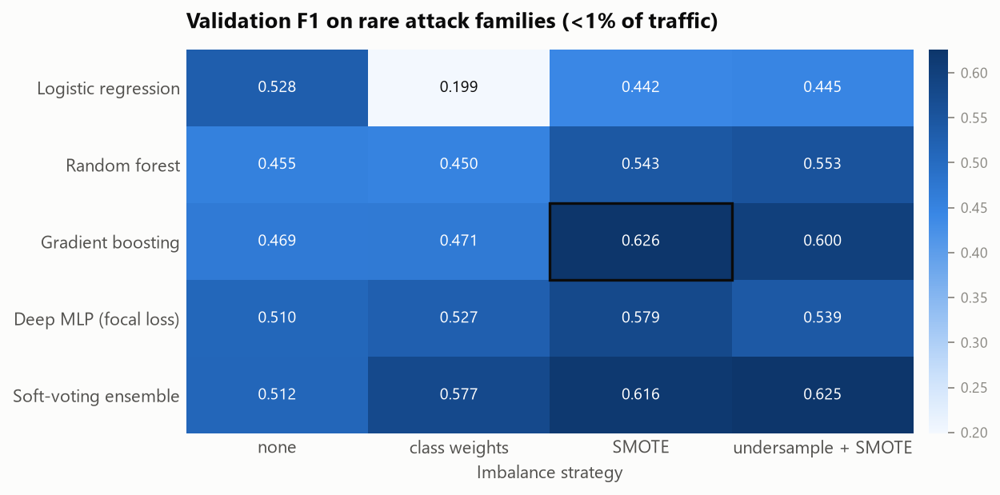

| Model | Imbalance strategy | Selection score | Macro-F1 | Rare-class F1 | Macro recall | MCC | PR-AUC | Detection | False alarms | Fit (s) |
|---|---|---|---|---|---|---|---|---|---|---|
| Soft-voting ensemble | undersample + SMOTE | 0.828 | 0.828 | 0.625 | 0.846 | 0.953 | 0.827 | 95.9% | 1.01% | 31 |
| Gradient boosting | SMOTE | 0.825 | 0.825 | 0.626 | 0.806 | 0.953 | 0.797 | 94.7% | 0.64% | 7 |
| Soft-voting ensemble | SMOTE | 0.824 | 0.824 | 0.616 | 0.808 | 0.958 | 0.830 | 95.0% | 0.59% | 74 |
| Gradient boosting | undersample + SMOTE | 0.816 | 0.816 | 0.600 | 0.830 | 0.950 | 0.839 | 95.6% | 1.06% | 5 |
| Soft-voting ensemble | class weights | 0.806 | 0.806 | 0.577 | 0.835 | 0.947 | 0.822 | 95.9% | 1.31% | 24 |
| Deep MLP (focal loss) | SMOTE | 0.805 | 0.805 | 0.579 | 0.864 | 0.926 | 0.831 | 96.1% | 2.33% | 56 |
| Random forest | undersample + SMOTE | 0.796 | 0.796 | 0.553 | 0.809 | 0.950 | 0.799 | 95.1% | 0.95% | 4 |
| Random forest | SMOTE | 0.791 | 0.791 | 0.543 | 0.775 | 0.956 | 0.803 | 94.4% | 0.49% | 14 |
| Deep MLP (focal loss) | undersample + SMOTE | 0.788 | 0.788 | 0.539 | 0.866 | 0.905 | 0.831 | 96.5% | 3.50% | 21 |
| Logistic regression | none | 0.784 | 0.784 | 0.528 | 0.738 | 0.960 | 0.830 | 93.6% | 0.12% | 1 |
| Deep MLP (focal loss) | class weights | 0.779 | 0.779 | 0.527 | 0.888 | 0.907 | 0.829 | 96.3% | 3.33% | 11 |
| Soft-voting ensemble | none | 0.778 | 0.778 | 0.512 | 0.745 | 0.961 | 0.805 | 93.9% | 0.15% | 22 |
| Deep MLP (focal loss) | none | 0.777 | 0.777 | 0.510 | 0.758 | 0.961 | 0.821 | 93.9% | 0.17% | 16 |
| Gradient boosting | none | 0.757 | 0.757 | 0.469 | 0.760 | 0.939 | 0.718 | 94.3% | 1.15% | 1 |
| Gradient boosting | class weights | 0.755 | 0.755 | 0.471 | 0.890 | 0.870 | 0.822 | 97.0% | 5.62% | 7 |
| Random forest | none | 0.752 | 0.752 | 0.455 | 0.705 | 0.959 | 0.819 | 93.0% | 0.01% | 6 |
| Random forest | class weights | 0.749 | 0.749 | 0.450 | 0.722 | 0.958 | 0.788 | 93.2% | 0.12% | 5 |
| Logistic regression | undersample + SMOTE | 0.742 | 0.742 | 0.445 | 0.901 | 0.874 | 0.819 | 96.9% | 5.29% | 2 |
| Logistic regression | SMOTE | 0.741 | 0.741 | 0.442 | 0.888 | 0.876 | 0.815 | 96.8% | 5.06% | 6 |
| Logistic regression | class weights | 0.594 | 0.594 | 0.199 | 0.923 | 0.655 | 0.759 | 98.1% | 24.06% | 3 |

## 3. Final model on the held-out test set

Deployed configuration: **Soft-voting ensemble, undersample + SMOTE** (best validation macro_f1 in the benchmark), combined with a Local Outlier Factor novelty detector trained on benign traffic (false-alarm budget 1.0% of benign traffic).

| Metric (test set) [95% CI] | Soft-voting ensemble, no imbalance handling | Soft-voting ensemble, undersample + SMOTE | + novelty detector (deployed) |
|---|---|---|---|
| Macro-F1 | 0.779 [0.754, 0.805] | 0.835 [0.815, 0.854] | 0.834 [0.815, 0.853] |
| Rare-class F1 (<1% families) | 0.519 [0.460, 0.574] | 0.644 [0.601, 0.687] | 0.644 [0.601, 0.687] |
| Macro recall | 0.745 [0.721, 0.768] | 0.867 [0.846, 0.891] | 0.866 [0.845, 0.889] |
| MCC | 0.960 | 0.952 | 0.927 |
| Macro PR-AUC | 0.823 | 0.860 | 0.860 |
| Detection rate (attacks alerted) | 93.56% [92.97, 94.11] | 95.68% [95.10, 96.21] | 95.75% [95.20, 96.31] |
| False-alarm rate (benign alerted) | 0.12% [0.07, 0.17] | 0.98% [0.83, 1.14] | 2.16% [1.94, 2.37] |

### 3.1 Is the gain real? Paired bootstrap

Both models are scored on the same 1,000 stratified bootstrap resamples of the test set (every resample keeps each family's size, so rare families never drop out). The CI of the *difference* says whether the improvement could be luck.

| Change | Metric | Δ [95% CI] | Resamples where it was not better |
|---|---|---|---|
| Imbalance handling (same model) | Macro-F1 | +0.055 [+0.032, +0.084] | 0.0% |
| Imbalance handling (same model) | Rare-class F1 (<1% families) | +0.125 [+0.072, +0.188] | 0.0% |
| Imbalance handling (same model) | Macro recall | +0.122 [+0.095, +0.149] | 0.0% |
| Imbalance handling (same model) | Detection rate (attacks alerted) | +2.12 pp [+1.74, +2.48] | 0.0% |
| Imbalance handling (same model) | False-alarm rate (benign alerted) | +0.87 pp [+0.72, +1.02] | 100.0% |
| Adding the novelty detector | Detection rate (attacks alerted) | +0.08 pp [+0.00, +0.18] | 4.5% |
| Adding the novelty detector | False-alarm rate (benign alerted) | +1.17 pp [+1.00, +1.34] | 100.0% |

Imbalance handling: macro-F1 +0.055 [+0.032, +0.084], rare-class F1 +0.125 [+0.072, +0.188]. Both intervals exclude zero: the gain is not a fluke of this test split.

Per-class results (classifier, test set):

| Class | Test flows | Precision | Recall | F1 | PR-AUC | F1, no imbalance handling | Δ F1 |
|---|---|---|---|---|---|---|---|
| Benign | 16,043 | 0.989 | 0.990 | 0.990 | 0.994 | 0.992 | -0.002 |
| Botnet | 124 | 0.907 | 0.944 | 0.925 | 0.965 | 0.908 | +0.017 |
| BruteForce | 296 | 0.997 | 0.970 | 0.983 | 0.975 | 0.983 | +0.000 |
| DDoS | 996 | 1.000 | 0.977 | 0.988 | 0.982 | 0.988 | +0.000 |
| DoS | 1,444 | 1.000 | 0.977 | 0.988 | 0.982 | 0.988 | +0.000 |
| Exfiltration | 29 | 0.622 | 0.966 | 0.757 | 0.935 | 0.702 | +0.055 |
| Infiltration | 34 | 0.385 | 0.441 | 0.411 | 0.445 | 0.162 | +0.249 |
| PortScan | 897 | 1.000 | 0.978 | 0.989 | 0.981 | 0.989 | +0.000 |
| WebAttack | 137 | 0.423 | 0.562 | 0.483 | 0.481 | 0.302 | +0.180 |

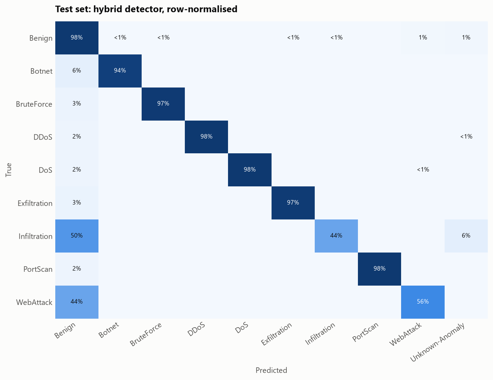

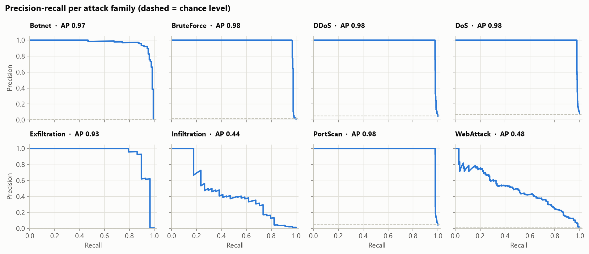

Training time 33 s. Inference (classifier + novelty detector): 37.1 ms per 1,000 flows ≈ 26,954 flows/s on one machine.

### 3.2 How optimistic is the headline? Three evaluation protocols

The same configuration (Soft-voting ensemble + undersample + SMOTE, classifier only) trained and tested under three protocols. Random splits are the field's default but let flows of one attack session sit on both sides; grouped and temporal splits remove that advantage.

| Protocol | Train / test flows | Macro-F1 [95% CI] | Rare-class F1 [95% CI] | False alarms | Families unseen in training | How it splits |
|---|---|---|---|---|---|---|
| Stratified random split | 70,000 / 20,000 | 0.835 [0.817, 0.854] | 0.644 [0.604, 0.688] | 0.98% | – | stratified random 70/10/20 split, as in the headline results |
| Session-grouped split | 80,009 / 19,991 | 0.850 [0.834, 0.867] | 0.674 [0.638, 0.712] | 1.00% | – | no session (source, destination, 1h window) spans train and test (0 shared) |
| Temporal split | 65,000 / 35,000 | 0.738 [0.726, 0.750] | 0.436 [0.409, 0.461] | 0.81% | Exfiltration | oldest 65% of flows train, newest test |

Macro-F1 change vs. the random split: session-grouped split +0.015; temporal split -0.097.

- **Session leakage: none detected.** Keeping whole sessions on one side does not lower the score, so the random-split number is not inflated by near-duplicate flows of the same session. This is expected here: the synthetic generator draws flows independently. On real captures, where flows of one session are correlated, this check is what exposes leakage.

- **Temporal split** is the honest estimate for deployment: tomorrow's traffic is never in the training set, and Exfiltration never appears before the cut, so no classifier can name it; that is the novelty detector's job (§6).

### 3.3 New: per-family guarantees with conformal prediction

A confidence of 0.7 promises nothing. **Mondrian (class-conditional) conformal prediction** calibrates one threshold per family on the validation split and returns a *set* of plausible families per flow, with a finite-sample guarantee that the true family is in the set for ≥ 90% of flows **of every family separately**. A marginal guarantee would be dominated by benign traffic and say almost nothing about a family that is 0.2% of flows.

| Family | Calibration flows | In the set when p ≥ | Coverage (target 90%) | Expected range (95%) | Mean set size | Single-family sets | Alerted under guaranteed-recall alerting |
|---|---|---|---|---|---|---|---|
| Benign | 8,022 | 0.850 | 99.0% | 89%–91% ✓ | 1.32 | 69% | 32.3% |
| Botnet | 62 | 0.697 | 94.4% | 82%–96% ✓ | 1.04 | 96% | 95.2% |
| BruteForce | 148 | 0.970 | 97.0% | 85%–95% ✓ | 1.01 | 99% | 98.0% |
| DDoS | 498 | 0.989 | 97.7% | 87%–93% ✓ | 1.01 | 99% | 98.3% |
| DoS | 722 | 0.984 | 97.7% | 88%–92% ✓ | 1.01 | 99% | 98.3% |
| Exfiltration | 14 | 0.242 | 96.6% | 77%–100% ✓ | 1.03 | 97% | 100.0% |
| Infiltration | 17 | 0.003 | 100.0% | 80%–100% ✓ | 1.56 | 44% | 100.0% |
| PortScan | 448 | 0.9998 | 97.8% | 87%–93% ✓ | 1.01 | 99% | 98.6% |
| WebAttack | 69 | 0.213 | 86.9% | 82%–96% ✓ | 1.66 | 43% | 95.6% |

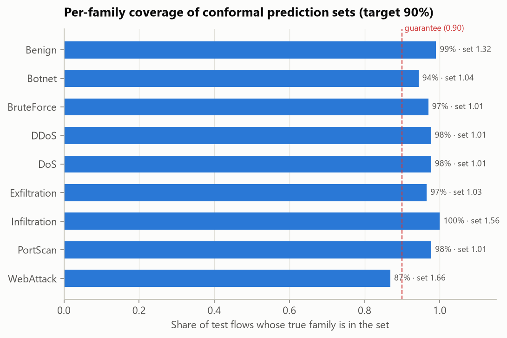

- Mean set size 1.27; 74% of flows get exactly one family. In the triage console an ambiguous set (more than one family) is a second *needs review* trigger next to low confidence. The two catch different cases, because thresholds differ per family: a 50/50 flow can still get a one-family set.
- The guarantee holds on average over calibration draws. With n calibration flows the realised coverage of a family varies within the *expected range* column (Beta distribution of conformal coverage); ✓ means the test-set coverage is consistent with the guarantee. Coverage *above* the range is expected: the most probable family is always added to the set, which can only raise coverage.
- **The price of a guarantee.** Alerting whenever *any* attack family is in the set (guaranteed-recall alerting) would detect 98.2% of attacks at 32.25% false alarms, vs. 95.8% at 2.16% for the deployed detector. The cost is driven by the families with the fewest calibration flows: Infiltration (17 flows) enters a set whenever p ≥ 0.003. **Every analyst-confirmed flow of a rare family tightens its threshold, so the feedback loop (§8) directly lowers the price of the guarantee.**

## 4. Explainability

Global: permutation importance, i.e. how much validation macro-F1 drops when one feature is shuffled.

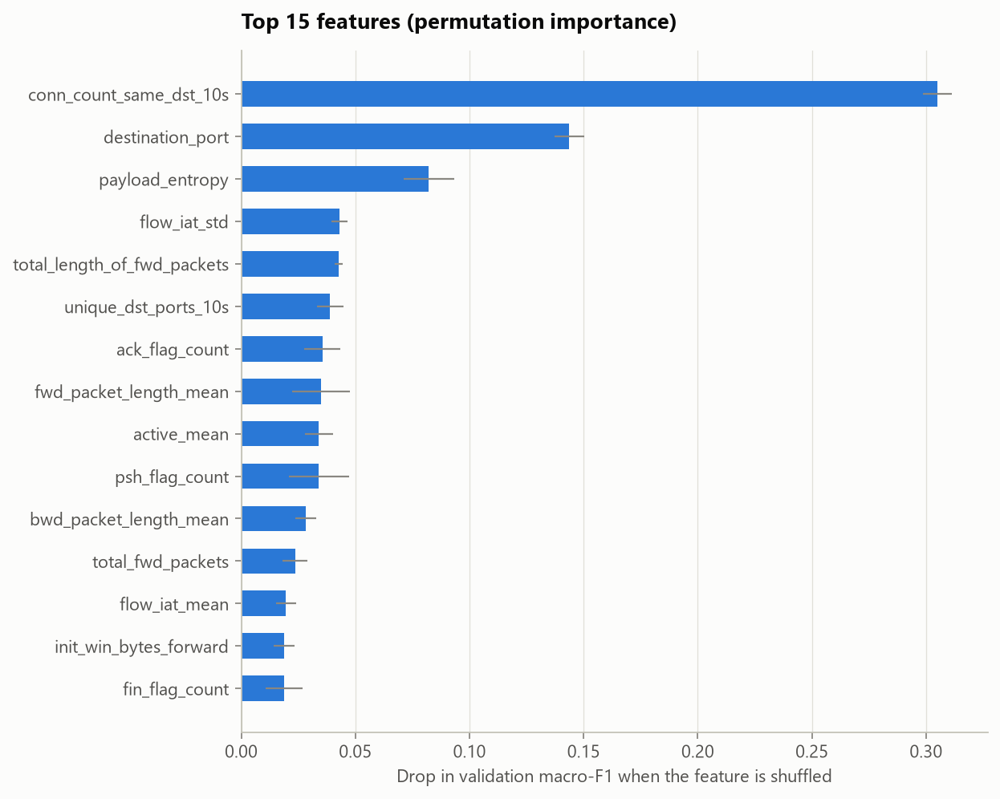

Local: every alert carries the features that deviate most from the benign baseline. Top of the test-set alert queue:

| alert_id | priority | predicted_class | confidence | explanation |
|---|---|---|---|---|
| A-000001 | P1 | DDoS | 1.0 | conn_count_same_dst_10s=150 (74 IQR above benign median 3); rst_flag_count=1 (4 IQR above benign median 0); payload_entropy=1.26 (2 IQR below benign median 6.9) |
| A-000029 | P1 | Botnet | 0.999 | conn_count_same_dst_10s=6 (2 IQR above benign median 3) |
| A-000290 | P1 | Exfiltration | 0.999 | conn_count_same_dst_10s=46 (22 IQR above benign median 3); syn_flag_count=0 (3 IQR below benign median 1); fin_flag_count=0 (1 IQR below benign median 1) |
| A-001010 | P1 | Infiltration | 0.918 | unique_dst_ports_10s=7 (11 IQR above benign median 1); idle_mean=2.0M (3 IQR above benign median 142k); total_length_of_fwd_packets=11k (2 IQR above benign median 1.7e+03) |
| A-001137 | P1 | DoS | 1.0 | active_mean=66.0M (95 IQR above benign median 142k); flow_duration=79.6M (54 IQR above benign median 327k); flow_iat_mean=2.8M (44 IQR above benign median 21k) |

## 5. Alert triage output

The test split produced **4,135 flow-level alerts** (P1: 2,612, P2: 453, P3: 1,070). 311 are flagged for manual review (prediction set is not a single family, or the family is unknown), including 191 `Unknown-Anomaly` alerts raised by the novelty detector.

Grouped by attack family, shared endpoint and time, they collapse into **430 incidents** (P1: 129, P2: 113, P3: 188), i.e. **10× fewer items** for an analyst to open. Largest incidents:

| Incident | Priority | Family | Flows | Shared endpoint |
|---|---|---|---|---|
| INC-00001 | P1 | DoS | 168 | 205.174.165.73 |
| INC-00002 | P1 | DoS | 150 | 205.174.165.73 |
| INC-00003 | P1 | DDoS | 125 | 192.168.10.50 |
| INC-00004 | P1 | DDoS | 118 | 192.168.10.50 |
| INC-00005 | P1 | DoS | 97 | 205.174.165.73 |

Open them in the analyst console: `streamlit run app/streamlit_app.py`.

## 6. Novel attacks: leave-one-attack-out

To simulate a zero-day, each attack family in turn is removed from training (Gradient boosting + SMOTE) and the model is asked to raise an alert on that family's test flows. Any non-benign label counts as a detection, because the analyst is alerted even when the family name is wrong.

Mean detection of unseen families: **40.5% classifier only → 59.1% with the novelty detector**, at the cost of 1.18% extra false alarms on benign traffic.

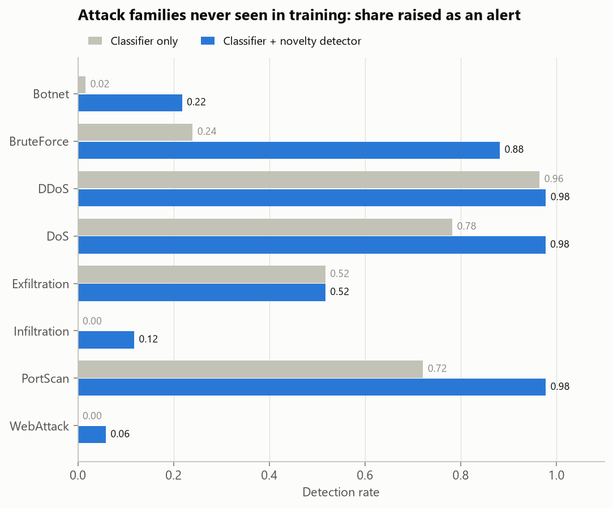

| Held-out family | Test flows | Classifier only | Classifier + novelty detector | Caught only by novelty detector | Label the classifier gave | False alarms (hybrid) |
|---|---|---|---|---|---|---|
| Botnet | 124 | 1.6% | 21.8% | 20.2% | WebAttack | 1.41% |
| BruteForce | 296 | 24.0% | 88.2% | 64.2% | DoS | 1.71% |
| DDoS | 996 | 96.5% | 97.8% | 1.3% | DoS | 1.54% |
| DoS | 1,444 | 78.3% | 97.7% | 19.5% | WebAttack | 1.80% |
| Exfiltration | 29 | 51.7% | 51.7% | 0.0% | DoS | 1.40% |
| Infiltration | 34 | 0.0% | 11.8% | 11.8% | Benign | 1.47% |
| PortScan | 897 | 72.1% | 97.8% | 25.6% | DDoS | 1.44% |
| WebAttack | 137 | 0.0% | 5.8% | 5.8% | Benign | 1.33% |

## 7. Drift over time

Train on history (2026-09-01 → 2026-09-07), evaluate on recent traffic (2026-09-07 → 2026-09-10). Then retrain with 3,500 labelled recent flows, i.e. what analysts confirm through the triage UI, and re-evaluate on the remaining 31,500.

| Metric (hybrid detector) | History (validation) | Recent traffic, static model | Recent traffic, retrained |
|---|---|---|---|
| Macro-F1 | 0.843 | 0.735 | 0.838 |
| Rare-class F1 (<1% families) | 0.603 | 0.441 | 0.649 |
| Detection rate (attacks alerted) | 96.06% | 93.96% | 94.96% |
| False-alarm rate (benign alerted) | 1.87% | 1.74% | 1.89% |

**Label-free drift monitor**: signals a production deployment can compute without ground truth.

| Signal | Value | Alert when |
|---|---|---|
| Max feature PSI, all traffic | 0.044 | > 0.25 |
| Max feature PSI, alerted traffic | 1.790 | > 0.25 |
| PSI of the predicted-class mix | 0.009 | > 0.1 |
| Unknown-Anomaly rate | 0.83% → 1.69% | doubles vs. history |
| Mean confidence of attack predictions | 0.972 → 0.848 | (context) |

Triggers fired: feature drift, unknown rate rise → retraining **triggered**. Drifted features: `conn_count_same_dst_10s`, `unique_dst_ports_10s`, `flow_iat_std`, `destination_port`, `flow_duration`, `idle_mean`, `flow_packets_s`, `active_mean`. Whole-traffic PSI alone can miss this kind of drift: attacks are a small share of all flows, so changes in them barely move whole-traffic distributions. That is why the monitor watches the alerted population and the prediction mix.

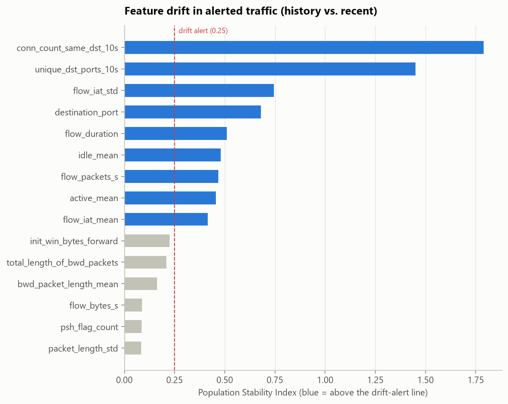

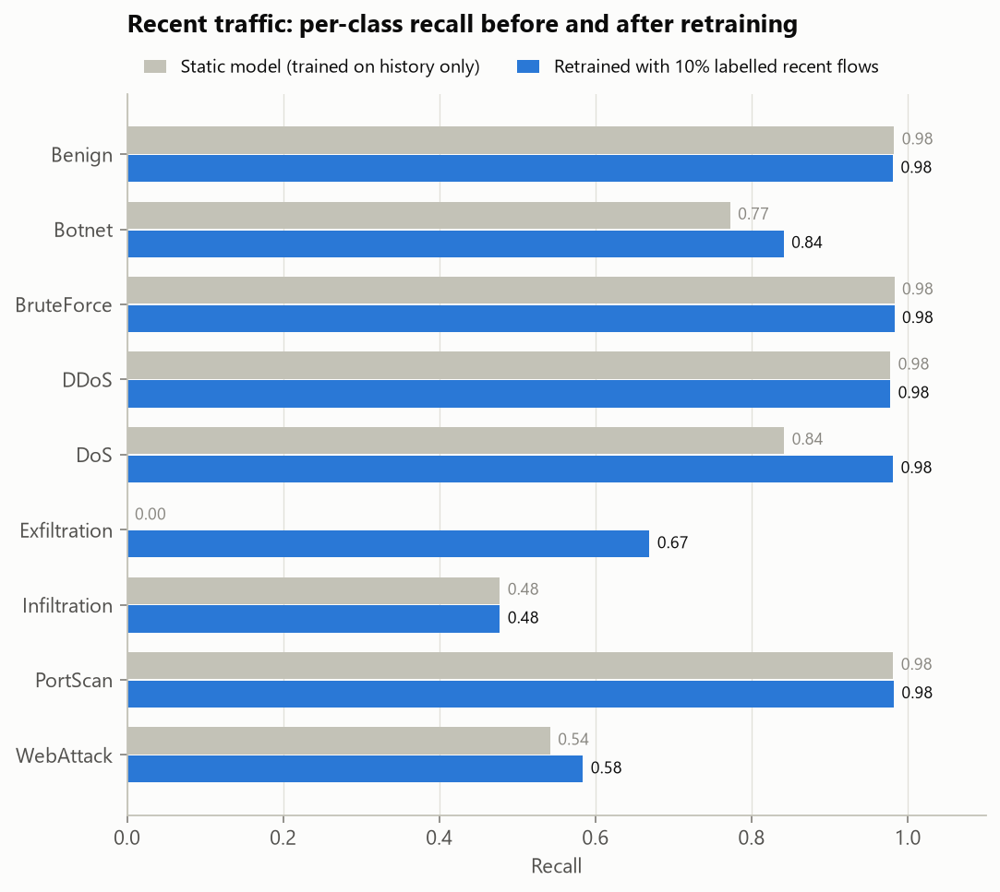

Attack families that only appear in recent traffic:

| Family | Flows | Static model: alerted | …as Unknown-Anomaly | Recall after retraining |
|---|---|---|---|---|
| Exfiltration | 130 | 42.3% | 4.6% | 0.669 |

## 8. Closing the loop: analyst feedback → retraining

Decisions made in the triage console are stored with each flow's feature values, so every decision is a labelled training example. Here a **simulated analyst** who reviews incidents flagged *needs review* first and labels every flow correctly (ground truth stands in for human judgement) worked through **100 incidents**, producing **267 labelled flows** (Benign: 83, WebAttack: 77, Botnet: 54, BruteForce: 28, Infiltration: 13, Exfiltration: 12). `nids retrain` added them to the original training data and refit the classifier and the novelty detector (30 s).

The 267 reviewed flows are removed from the test set before comparing, because they are training data now:

| Unreviewed test flows (n = 19,733) | Deployed model | Retrained with analyst feedback |
|---|---|---|
| Macro-F1 | 0.739 | 0.765 |
| Rare-class F1 (<1% families) | 0.429 | 0.489 |
| Macro recall | 0.763 | 0.802 |
| Detection rate (attacks alerted) | 95.55% | 95.92% |
| False-alarm rate (benign alerted) | 1.65% | 1.85% |
| Incidents in the queue | 330 | 381 |
| Unknown-Anomaly alerts | 182 | 182 |

Net effect with 95% paired-bootstrap CIs: Rare-class F1 (<1% families) +0.060 [+0.016, +0.104]; Macro-F1 +0.027 [+0.007, +0.046]; False-alarm rate (benign alerted) +0.20 pp [+0.11, +0.29]. The improvement in Rare-class F1 and Macro-F1 holds across resamples.

How to read this: removing the reviewed flows also removes the deployed model's reviewed hits and false alarms. What remains is the traffic analysts did not look at, including the attacks the deployed model missed entirely. The comparison measures what retraining changes there, not on flows it was taught.

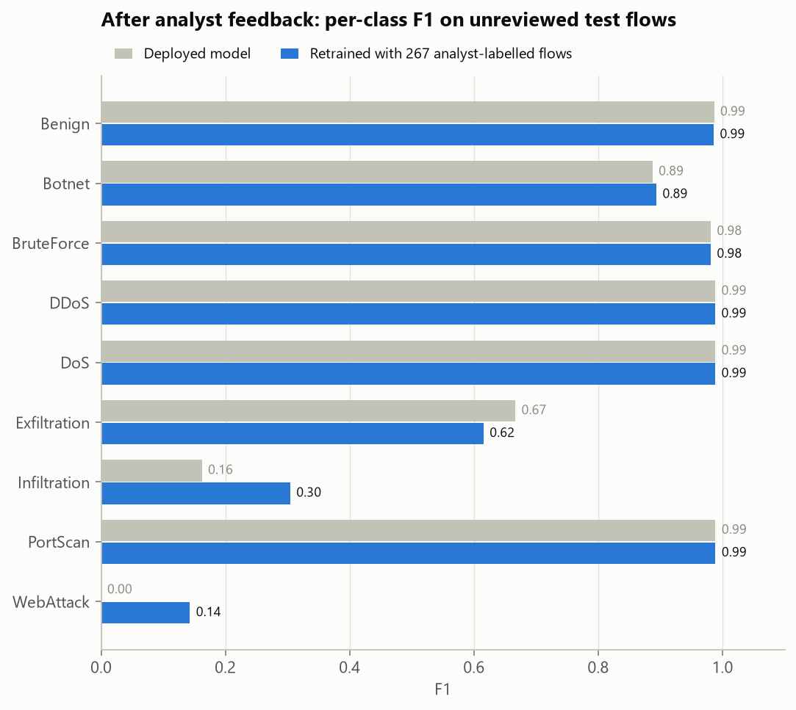

## 9. Limitations and next steps

- **Flow features only.** Payload-level attacks that leave flow statistics untouched are invisible; pairing NetSentinel with signature IDS (Suricata/Zeek) covers that gap.
- **Random splits overestimate.** Stratified random splits put flows from the same attack session in train and test. The temporal experiment (section 7) is the more realistic estimate; use it when timestamps exist.
- **SMOTE creates plausible but synthetic flows** in feature space; it never touches validation/test data, but very rare families (tens of flows) remain hard to learn and should be reported with that caveat.
- **Anomaly threshold is a budget.** A 1% benign false-alarm budget is cheap at the flow level but can be noisy at SOC scale; tune `novelty.benign_fpr` to the team's alert capacity.
- Next: adversarial robustness checks (feature-space evasion), streaming deployment (Kafka/Zeek logs → `nids score`), active learning that routes the least-confident alerts to analysts first.
