# NetSentinel: evaluation report

_Generated 2026-10-11 08:23 UTC from `data/raw/cicids2017`._

## 1. Dataset

- Source: `data/raw/cicids2017`, label column `label`
- 605,980 flows used; 71 features (71 numeric, 0 categorical)
- Imbalance ratio (largest / smallest class): **45,337 : 1**
- Exact duplicate flows removed: 308,218
- **Stratified sample** of 605,980 of the 2,522,525 cleaned flows. Families with fewer than 5,000 flows are kept whole, so they are over-represented relative to benign traffic compared with the full capture: their test *precision* is somewhat optimistic, while recall is unaffected.
- Stratified split: 424,186 train / 60,598 validation / 121,196 test

| Class | Flows | Share |
|---|---|---|
| Benign | 498,702 | 82.30% |
| Botnet | 1,953 | 0.32% |
| BruteForce | 5,000 | 0.83% |
| DDoS | 30,449 | 5.02% |
| DoS | 46,084 | 7.60% |
| Exploit | 11 | 0.00% |
| Infiltration | 36 | 0.01% |
| PortScan | 21,602 | 3.56% |
| WebAttack | 2,143 | 0.35% |

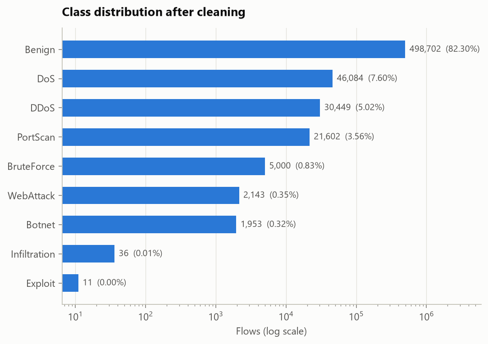

### Data audit

- Missing values: `flow_bytes_s` 0.06%, `flow_packets_s` 0.06% (imputed with the training median inside the pipeline).
- Identifier- or clock-like numeric columns: none found.
- **Shortcut scan.** A depth-4 tree is trained on each feature *alone*. A feature that nearly matches the full model, or perfectly isolates one family, is flagged for a human to judge: real attack behaviour (a scan *is* many destination ports) or a capture artefact (a lab IP, TTL or window size).

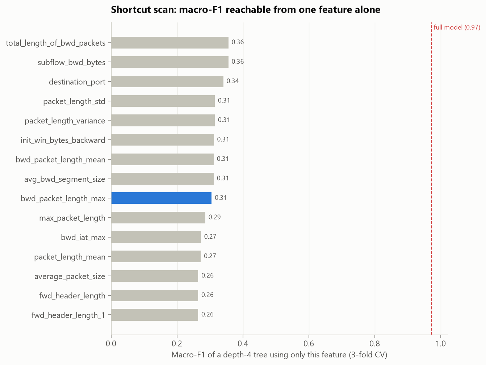

| Feature | Macro-F1 from this feature alone | Share of full model | Family it isolates best (F1) | Flag |
|---|---|---|---|---|
| `total_length_of_bwd_packets` | 0.356 | 37% | Exploit (0.91) | – |
| `subflow_bwd_bytes` | 0.356 | 37% | Exploit (0.91) | – |
| `destination_port` | 0.341 | 35% | BruteForce (0.82) | – |
| `packet_length_std` | 0.315 | 32% | DoS (0.71) | – |
| `packet_length_variance` | 0.315 | 32% | DoS (0.71) | – |
| `init_win_bytes_backward` | 0.312 | 32% | DoS (0.93) | – |
| `bwd_packet_length_mean` | 0.311 | 32% | Exploit (0.86) | – |
| `avg_bwd_segment_size` | 0.311 | 32% | Exploit (0.86) | – |

Flagged (blue in the chart): `bwd_packet_length_max`. No single feature comes close to the full model, so the classifier is not riding on one shortcut. Flagged features isolate one family each; check that this reflects attack behaviour.

## 2. Benchmark: models × imbalance strategies

Every combination was trained on the training split and scored on the **validation** split. The test split is not touched until section 3.

**Selection score** = macro-F1 over the 7 families with at least 10 validation flows. Excluded from *selection* (still evaluated everywhere): Exploit (1 validation flow), Infiltration (4 validation flows). With so few flows a family's F1 is 0 or 1 by the luck of a single flow, which would move a 9-family macro-F1 by up to 0.11, more than the real gap between good configurations.

**Takeaway:** the winner is **Soft-voting ensemble + SMOTE**, i.e. an imbalance strategy. Best with imbalance handling: Soft-voting ensemble + SMOTE (score 0.989, rare-class F1 0.986); best on the natural distribution: Soft-voting ensemble (score 0.983, rare-class F1 0.713). Difference: **+0.005** selection score.

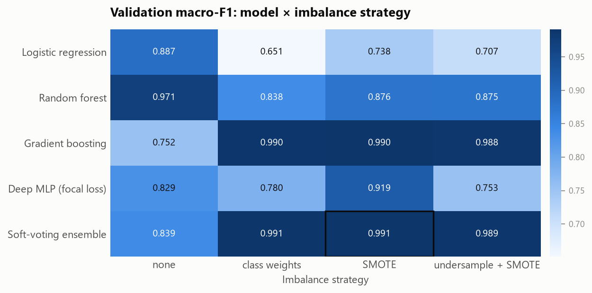

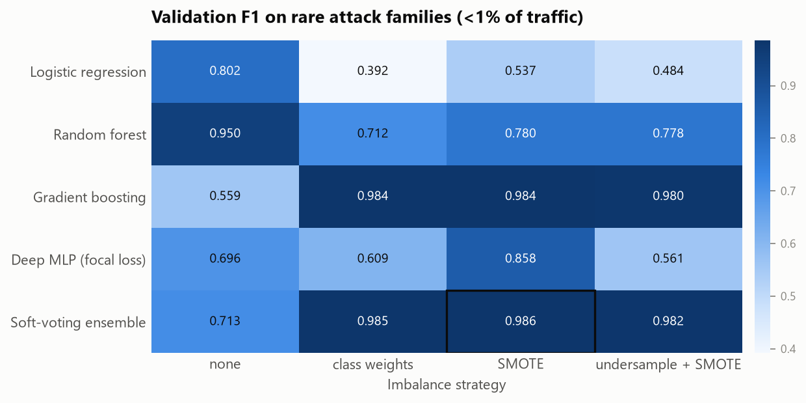

| Model | Imbalance strategy | Selection score | Macro-F1 | Rare-class F1 | Macro recall | MCC | PR-AUC | Detection | False alarms | Fit (s) |
|---|---|---|---|---|---|---|---|---|---|---|
| Soft-voting ensemble | SMOTE | 0.989 | 0.991 | 0.986 | 0.997 | 0.996 | 0.995 | 99.9% | 0.11% | 116 |
| Soft-voting ensemble | class weights | 0.988 | 0.991 | 0.985 | 0.996 | 0.996 | 0.995 | 99.9% | 0.13% | 95 |
| Gradient boosting | SMOTE | 0.987 | 0.990 | 0.984 | 0.997 | 0.996 | 0.997 | 99.9% | 0.12% | 17 |
| Gradient boosting | class weights | 0.987 | 0.990 | 0.984 | 0.997 | 0.995 | 0.997 | 99.9% | 0.17% | 40 |
| Soft-voting ensemble | undersample + SMOTE | 0.986 | 0.989 | 0.982 | 0.997 | 0.995 | 0.995 | 99.9% | 0.15% | 29 |
| Gradient boosting | undersample + SMOTE | 0.984 | 0.988 | 0.980 | 0.996 | 0.995 | 0.998 | 99.9% | 0.15% | 9 |
| Soft-voting ensemble | none | 0.983 | 0.839 | 0.713 | 0.820 | 0.994 | 0.829 | 99.5% | 0.10% | 44 |
| Random forest | SMOTE | 0.983 | 0.876 | 0.780 | 0.879 | 0.994 | 0.994 | 99.5% | 0.13% | 21 |
| Random forest | class weights | 0.983 | 0.838 | 0.712 | 0.820 | 0.993 | 0.996 | 99.4% | 0.11% | 12 |
| Random forest | undersample + SMOTE | 0.983 | 0.875 | 0.778 | 0.882 | 0.994 | 0.993 | 99.7% | 0.17% | 8 |
| Random forest | none | 0.983 | 0.971 | 0.950 | 0.957 | 0.993 | 0.994 | 99.4% | 0.11% | 11 |
| Gradient boosting | none | 0.966 | 0.752 | 0.559 | 0.788 | 0.978 | 0.742 | 99.2% | 0.64% | 4 |
| Deep MLP (focal loss) | none | 0.959 | 0.829 | 0.696 | 0.817 | 0.990 | 0.916 | 99.0% | 0.14% | 32 |
| Deep MLP (focal loss) | SMOTE | 0.953 | 0.919 | 0.858 | 0.966 | 0.986 | 0.955 | 99.8% | 0.48% | 88 |
| Logistic regression | none | 0.938 | 0.887 | 0.802 | 0.916 | 0.983 | 0.860 | 98.5% | 0.29% | 14 |
| Deep MLP (focal loss) | class weights | 0.896 | 0.780 | 0.609 | 0.985 | 0.963 | 0.877 | 99.6% | 1.36% | 46 |
| Deep MLP (focal loss) | undersample + SMOTE | 0.877 | 0.753 | 0.561 | 0.966 | 0.946 | 0.935 | 99.8% | 2.13% | 19 |
| Logistic regression | SMOTE | 0.859 | 0.738 | 0.537 | 0.988 | 0.926 | 0.867 | 99.6% | 2.94% | 39 |
| Logistic regression | undersample + SMOTE | 0.849 | 0.707 | 0.484 | 0.988 | 0.919 | 0.776 | 99.7% | 3.33% | 16 |
| Logistic regression | class weights | 0.792 | 0.651 | 0.392 | 0.991 | 0.871 | 0.763 | 99.9% | 5.81% | 14 |

## 3. Final model on the held-out test set

Deployed configuration: **Soft-voting ensemble, SMOTE** (best validation macro_f1 in the benchmark), combined with a Local Outlier Factor novelty detector trained on benign traffic (false-alarm budget 1.0% of benign traffic).

| Metric (test set) [95% CI] | Soft-voting ensemble, no imbalance handling | Soft-voting ensemble, SMOTE | + novelty detector (deployed) |
|---|---|---|---|
| Macro-F1 | 0.766 [0.763, 0.768] | 0.973 [0.945, 0.992] | 0.972 [0.945, 0.991] |
| Macro-F1, families with ≥ 10 test flows | 0.984 [0.981, 0.988] | 0.989 [0.986, 0.992] | 0.988 [0.986, 0.991] |
| Rare-class F1 (<1% families) | 0.580 [0.576, 0.585] | 0.953 [0.903, 0.988] | 0.953 [0.903, 0.988] |
| Macro recall | 0.765 [0.762, 0.768] | 0.965 [0.931, 0.997] | 0.964 [0.930, 0.996] |
| MCC | 0.995 | 0.996 | 0.969 |
| Macro PR-AUC | 0.773 | 0.974 | 0.974 |
| Detection rate (attacks alerted) | 99.55% [99.46, 99.63] | 99.87% [99.82, 99.92] | 99.87% [99.82, 99.92] |
| False-alarm rate (benign alerted) | 0.09% [0.07, 0.11] | 0.10% [0.08, 0.12] | 1.18% [1.11, 1.25] |

**Families with fewer than 10 test flows**: **Exploit**: 2 of 2 found (vs. 0 of 2 with no imbalance handling); **Infiltration**: 5 of 7 found (vs. 0 of 7 with no imbalance handling). Their F1 is decided by one or two flows, and a bootstrap cannot express that uncertainty (resampling two correctly found flows always gives F1 = 1), so they are reported as counts. They dominate the all-family macro-F1, which is why the row *Macro-F1, families with ≥ 10 test flows* is the measurable comparison.

### 3.1 Is the gain real? Paired bootstrap

Both models are scored on the same 1,000 stratified bootstrap resamples of the test set (every resample keeps each family's size, so rare families never drop out). The CI of the *difference* says whether the improvement could be luck.

| Change | Metric | Δ [95% CI] | Resamples where it was not better |
|---|---|---|---|
| Imbalance handling (same model) | Macro-F1 | +0.208 [+0.180, +0.227] | 0.0% |
| Imbalance handling (same model) | Macro-F1, families with ≥ 10 test flows | +0.005 [+0.003, +0.007] | 0.0% |
| Imbalance handling (same model) | Rare-class F1 (<1% families) | +0.373 [+0.323, +0.408] | 0.0% |
| Imbalance handling (same model) | Macro recall | +0.200 [+0.165, +0.233] | 0.0% |
| Imbalance handling (same model) | Detection rate (attacks alerted) | +0.33 pp [+0.25, +0.40] | 0.0% |
| Imbalance handling (same model) | False-alarm rate (benign alerted) | +0.01 pp [+0.00, +0.02] | 99.9% |
| Adding the novelty detector | Detection rate (attacks alerted) | +0.00 pp [+0.00, +0.00] | 100.0% |
| Adding the novelty detector | False-alarm rate (benign alerted) | +1.07 pp [+1.01, +1.14] | 100.0% |

Imbalance handling: all-family macro-F1 +0.208 [+0.180, +0.227], rare-class F1 +0.373 [+0.323, +0.408]. These intervals look decisive but cannot reflect the uncertainty of the tiny families that drive them (see above). The measurable claim is the change on families with at least 10 test flows: +0.005 [+0.003, +0.007] (significant).

Per-class results (classifier, test set):

| Class | Test flows | Precision | Recall | F1 | PR-AUC | F1, no imbalance handling | Δ F1 |
|---|---|---|---|---|---|---|---|
| Benign | 99,740 | 1.000 | 0.999 | 0.999 | 1.000 | 0.999 | +0.000 |
| Botnet | 391 | 0.900 | 0.990 | 0.943 | 0.976 | 0.920 | +0.023 |
| BruteForce | 1,000 | 1.000 | 0.999 | 0.999 | 0.999 | 0.998 | +0.002 |
| DDoS | 6,090 | 1.000 | 0.999 | 1.000 | 1.000 | 0.999 | +0.000 |
| DoS | 9,217 | 0.997 | 0.999 | 0.998 | 1.000 | 0.997 | +0.001 |
| Exploit | 2 | 1.000 | 1.000 | 1.000 | 1.000 | 0.000 | +1.000 |
| Infiltration | 7 | 1.000 | 0.714 | 0.833 | 0.793 | 0.000 | +0.833 |
| PortScan | 4,320 | 0.990 | 0.999 | 0.994 | 0.998 | 0.994 | +0.000 |
| WebAttack | 429 | 0.995 | 0.986 | 0.991 | 0.998 | 0.982 | +0.008 |

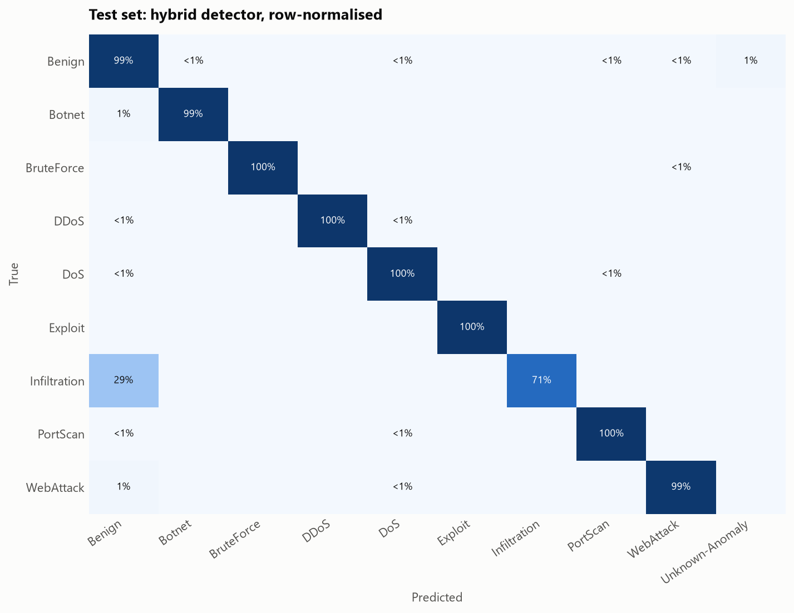

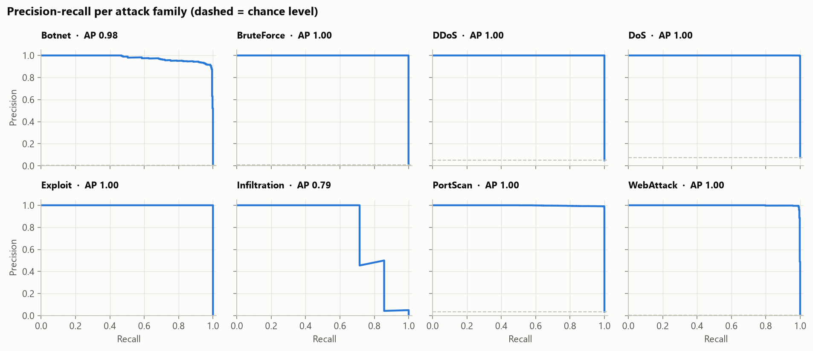

Training time 409 s. Inference (classifier + novelty detector): 43.4 ms per 1,000 flows ≈ 23,052 flows/s on one machine.

### 3.2 How optimistic is the headline? Three evaluation protocols

The same configuration (Soft-voting ensemble + SMOTE, classifier only) trained and tested under three protocols. Random splits are the field's default but let flows of one attack session sit on both sides; grouped and temporal splits remove that advantage.

| Protocol | Train / test flows | Macro-F1 [95% CI] | Rare-class F1 [95% CI] | False alarms | Families unseen in training | How it splits |
|---|---|---|---|---|---|---|
| Stratified random split | 424,186 / 121,196 | 0.973 [0.946, 0.992] | 0.953 [0.905, 0.988] | 0.10% | – | stratified random 70/10/20 split, as in the headline results |
| Session-grouped split | 485,530 / 120,450 | 0.888 [0.836, 0.912] | 0.898 [0.805, 0.941] | 0.08% | – | no session (source, destination, 5min window) spans train and test (0 shared) |
| Temporal split | 393,887 / 212,093 | 0.180 [0.180, 0.180] | 0.000 [0.000, 0.000] | 0.03% | Botnet, DDoS, Infiltration, PortScan | oldest 65% of flows train, newest test |

Macro-F1 change vs. the random split: session-grouped split -0.085; temporal split -0.793.

- **Session leakage detected.** Holding out whole sessions lowers the score beyond the random-split confidence interval: part of the headline comes from flows of the same session on both sides. Quote the session-grouped number as the realistic estimate.

- **Temporal split** is the honest estimate for deployment: tomorrow's traffic is never in the training set, and Botnet, DDoS, Infiltration, PortScan never appear before the cut, so no classifier can name them; that is the novelty detector's job (§6).

### 3.3 New: per-family guarantees with conformal prediction

A confidence of 0.7 promises nothing. **Mondrian (class-conditional) conformal prediction** calibrates one threshold per family on the validation split and returns a *set* of plausible families per flow, with a finite-sample guarantee that the true family is in the set for ≥ 90% of flows **of every family separately**. A marginal guarantee would be dominated by benign traffic and say almost nothing about a family that is 0.2% of flows.

| Family | Calibration flows | In the set when p ≥ | Coverage (target 90%) | Expected range (95%) | Mean set size | Single-family sets | Alerted under guaranteed-recall alerting |
|---|---|---|---|---|---|---|---|
| Benign | 49,870 | 0.9996 | 99.9% | 90%–90% ✓ | 1.00 | 100% | 0.1% |
| Botnet | 195 | 0.840 | 99.0% | 86%–94% ✓ | 1.00 | 100% | 99.0% |
| BruteForce | 500 | 0.9991 | 99.9% | 87%–92% ✓ | 1.00 | 100% | 100.0% |
| DDoS | 3,045 | 0.9991 | 99.9% | 89%–91% ✓ | 1.00 | 100% | 100.0% |
| DoS | 4,609 | 0.992 | 99.9% | 89%–91% ✓ | 1.00 | 100% | 99.9% |
| Exploit | 1 | top prediction only | 100.0% | no guarantee possible | 1.00 | 100% | 100.0% |
| Infiltration | 4 | top prediction only | 71.4% | no guarantee possible | 1.00 | 100% | 71.4% |
| PortScan | 2,160 | 0.949 | 99.9% | 89%–91% ✓ | 1.00 | 100% | 100.0% |
| WebAttack | 214 | 0.975 | 98.6% | 86%–94% ✓ | 1.00 | 100% | 98.8% |

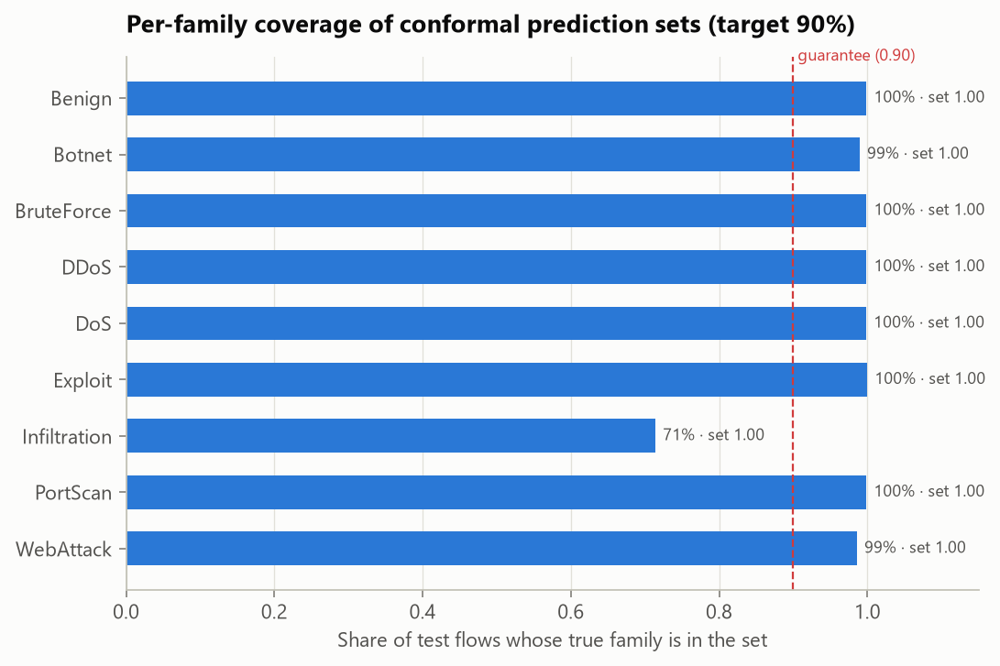

- Mean set size 1.00; 100% of flows get exactly one family. In the triage console an ambiguous set (more than one family) is a second *needs review* trigger next to low confidence. The two catch different cases, because thresholds differ per family: a 50/50 flow can still get a one-family set.
- The guarantee holds on average over calibration draws. With n calibration flows the realised coverage of a family varies within the *expected range* column (Beta distribution of conformal coverage); ✓ means the test-set coverage is consistent with the guarantee. Coverage *above* the range is expected: the most probable family is always added to the set, which can only raise coverage.
- **The price of a guarantee.** Alerting whenever *any* attack family is in the set (guaranteed-recall alerting) would detect 99.9% of attacks at 0.10% false alarms, vs. 99.9% at 1.18% for the deployed detector. Here the guarantee is nearly free: the classifier is confident enough that a second family rarely enters a set.
- **No guarantee is possible** for Exploit (1 calibration flow), Infiltration (4 calibration flows): a 90% guarantee needs at least 9 calibration flows of the family. The strict procedure would then put the family into *every* set, which tells an analyst nothing, so these families appear in a set only as the top prediction, and their coverage is simply their recall. Collecting labelled flows of them (§8) is what makes a guarantee possible.

## 4. Explainability

Global: permutation importance, i.e. how much validation macro-F1 drops when one feature is shuffled.

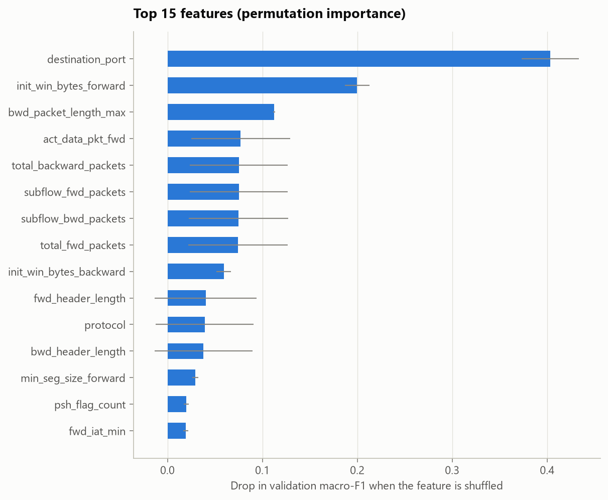

Local: every alert carries the features that deviate most from the benign baseline. Top of the test-set alert queue:

| alert_id | priority | predicted_class | confidence | explanation |
|---|---|---|---|---|
| A-000001 | P1 | DDoS | 1.0 | bwd_packet_length_std=3.33e+03 (575 IQR above benign median 0); packet_length_variance=7.0M (536 IQR above benign median 941); bwd_packet_length_max=7.22e+03 (36 IQR above benign median 93) |

## 5. Alert triage output

The test split produced **22,601 flow-level alerts** (P1: 16,066, P2: 1,103, P3: 1,076, P4: 4,356). 1,099 are flagged for manual review (prediction set is not a single family, or the family is unknown), including 1,069 `Unknown-Anomaly` alerts raised by the novelty detector.

Grouped by attack family, shared endpoint and time, they collapse into **483 incidents** (P1: 25, P2: 21, P3: 436, P4: 1), i.e. **47× fewer items** for an analyst to open. Largest incidents:

| Incident | Priority | Family | Flows | Shared endpoint |
|---|---|---|---|---|
| INC-00001 | P1 | DoS | 9204 | 172.16.0.1 |
| INC-00002 | P1 | DDoS | 6084 | 172.16.0.1 |
| INC-00003 | P1 | Botnet | 269 | 205.174.165.73 |
| INC-00004 | P1 | Botnet | 41 | 192.168.10.15 |
| INC-00005 | P1 | Botnet | 36 | 192.168.10.14 |

Open them in the analyst console: `streamlit run app/streamlit_app.py`.

## 6. Novel attacks: leave-one-attack-out

To simulate a zero-day, each attack family in turn is removed from training (Gradient boosting + SMOTE) and the model is asked to raise an alert on that family's test flows. Any non-benign label counts as a detection, because the analyst is alerted even when the family name is wrong.

Mean detection of unseen families: **5.2% classifier only → 33.4% with the novelty detector**, at the cost of 1.08% extra false alarms on benign traffic.

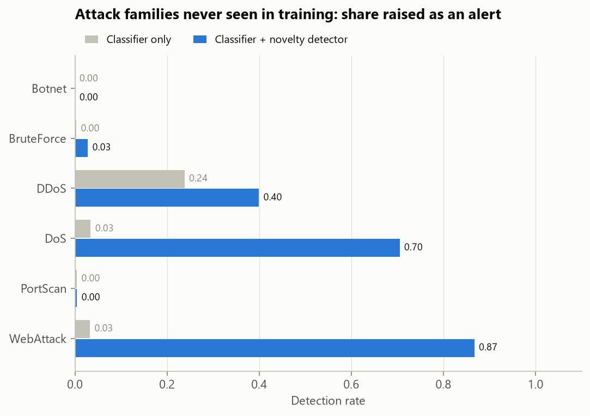

| Held-out family | Test flows | Classifier only | Classifier + novelty detector | Caught only by novelty detector | Label the classifier gave | False alarms (hybrid) |
|---|---|---|---|---|---|---|
| Botnet | 391 | 0.0% | 0.0% | 0.0% | Benign | 1.13% |
| BruteForce | 1,000 | 0.3% | 2.8% | 2.5% | PortScan | 1.18% |
| DDoS | 6,090 | 23.8% | 39.9% | 16.1% | DoS | 1.17% |
| DoS | 9,217 | 3.4% | 70.5% | 67.1% | PortScan | 1.17% |
| PortScan | 4,320 | 0.4% | 0.4% | 0.0% | DoS | 1.13% |
| WebAttack | 429 | 3.3% | 86.7% | 83.4% | DoS | 1.18% |

## 7. Drift over time

Train on history (2017-07-03 → 2017-07-06), evaluate on recent traffic (2017-07-06 → 2017-07-07). Then retrain with 21,210 labelled recent flows, i.e. what analysts confirm through the triage UI, and re-evaluate on the remaining 190,883.

| Metric (hybrid detector) | History (validation) | Recent traffic, static model | Recent traffic, retrained |
|---|---|---|---|
| Macro-F1 | 0.998 | 0.182 | 0.925 |
| Rare-class F1 (<1% families) | 0.999 | 0.000 | 0.819 |
| Detection rate (attacks alerted) | 99.91% | 49.77% | 99.71% |
| False-alarm rate (benign alerted) | 1.01% | 1.86% | 0.98% |

**Label-free drift monitor**: signals a production deployment can compute without ground truth.

| Signal | Value | Alert when |
|---|---|---|
| Max feature PSI, all traffic | 0.358 | > 0.25 |
| Max feature PSI, alerted traffic | 5.293 | > 0.25 |
| PSI of the predicted-class mix | 0.169 | > 0.1 |
| Unknown-Anomaly rate | 0.87% → 5.36% | doubles vs. history |
| Mean confidence of attack predictions | 0.993 → 0.693 | (context) |

Triggers fired: feature drift, prediction mix shift, unknown rate rise → retraining **triggered**. Drifted features: `fwd_packet_length_max`, `subflow_fwd_bytes`, `total_length_of_fwd_packets`, `bwd_header_length`, `fwd_packet_length_std`, `init_win_bytes_backward`, `fwd_header_length_1`, `fwd_header_length`. Whole-traffic PSI alone can miss this kind of drift: attacks are a small share of all flows, so changes in them barely move whole-traffic distributions. That is why the monitor watches the alerted population and the prediction mix.

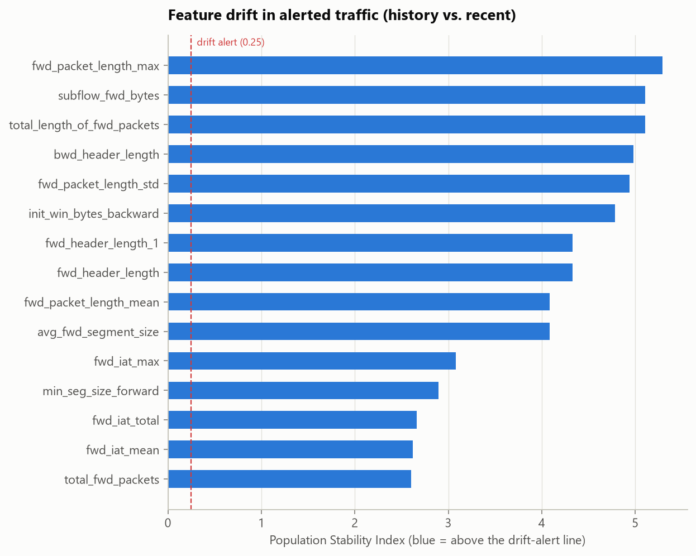

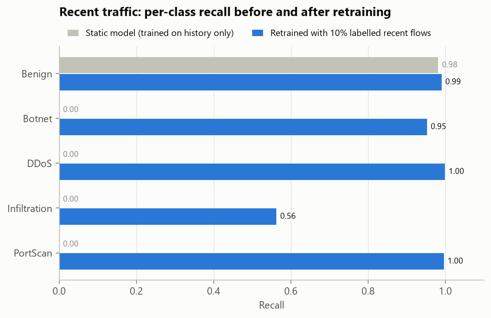

Attack families that only appear in recent traffic:

| Family | Flows | Static model: alerted | …as Unknown-Anomaly | Recall after retraining |
|---|---|---|---|---|
| Botnet | 1758 | 0.8% | 0.8% | 0.952 |
| DDoS | 27404 | 61.1% | 0.8% | 0.999 |
| Infiltration | 32 | 6.2% | 6.2% | 0.562 |
| PortScan | 19442 | 38.3% | 38.0% | 0.996 |

## 8. Closing the loop: analyst feedback → retraining

Decisions made in the triage console are stored with each flow's feature values, so every decision is a labelled training example. Here a **simulated analyst** who reviews incidents flagged *needs review* first and labels every flow correctly (ground truth stands in for human judgement) worked through **100 incidents**, producing **20,864 labelled flows** (DoS: 9,204, DDoS: 6,087, PortScan: 4,315, BruteForce: 665, Benign: 520, Botnet: 72, WebAttack: 1). `nids retrain` added them to the original training data and refit the classifier and the novelty detector (422 s).

The 20,864 reviewed flows are removed from the test set before comparing, because they are training data now:

| Unreviewed test flows (n = 100,332) | Deployed model | Retrained with analyst feedback |
|---|---|---|
| Macro-F1 | 0.640 | 0.666 |
| Rare-class F1 (<1% families) | 0.596 | 0.625 |
| Macro recall | 0.631 | 0.693 |
| Detection rate (attacks alerted) | 97.57% | 97.93% |
| False-alarm rate (benign alerted) | 0.66% | 0.83% |
| Incidents in the queue | 308 | 375 |
| Unknown-Anomaly alerts | 564 | 731 |

Net effect with 95% paired-bootstrap CIs: Rare-class F1 (<1% families) +0.029 [+0.005, +0.055]; Macro-F1 +0.026 [+0.004, +0.049]; False-alarm rate (benign alerted) +0.17 pp [+0.12, +0.22]. The improvement in Rare-class F1 and Macro-F1 holds across resamples.

How to read this: removing the reviewed flows also removes the deployed model's reviewed hits and false alarms. What remains is the traffic analysts did not look at, including the attacks the deployed model missed entirely. The comparison measures what retraining changes there, not on flows it was taught.

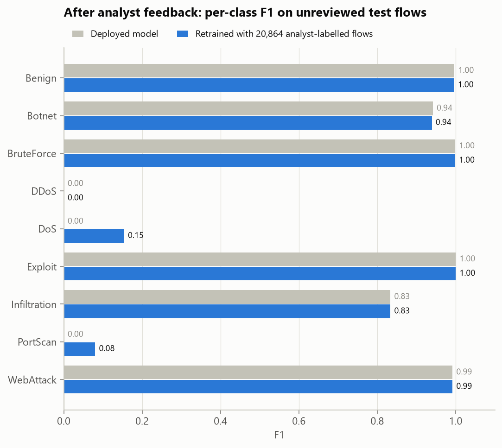

## 9. Limitations and next steps

- **Flow features only.** Payload-level attacks that leave flow statistics untouched are invisible; pairing NetSentinel with signature IDS (Suricata/Zeek) covers that gap.
- **Random splits overestimate.** Stratified random splits put flows from the same attack session in train and test. The temporal experiment (section 7) is the more realistic estimate; use it when timestamps exist.
- **SMOTE creates plausible but synthetic flows** in feature space; it never touches validation/test data, but very rare families (tens of flows) remain hard to learn and should be reported with that caveat.
- **Anomaly threshold is a budget.** A 1% benign false-alarm budget is cheap at the flow level but can be noisy at SOC scale; tune `novelty.benign_fpr` to the team's alert capacity.
- Next: adversarial robustness checks (feature-space evasion), streaming deployment (Kafka/Zeek logs → `nids score`), active learning that routes the least-confident alerts to analysts first.
